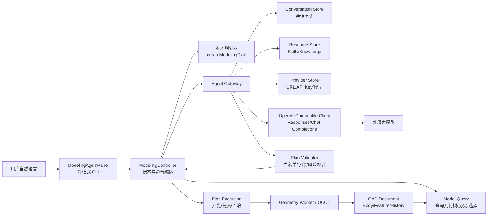

# 当前工作台 Agent 架构（2026-11-15）

本节按当前源码整理。能力协商、修订绑定和资源完整性修复已在独立候选验收，尚未替换日常服务/原生程序；不能用源码状态推断运行版本已经升级。后半部分保留早期结构化规划器记录，但**不是当前工作台架构**；旧 Tool Calling Loop 文档同样仅说明兼容实现。

## 当前执行链

```text
PiModelingAgentPanel / PiEventConnection
  → Gateway PiRpcRuntime（工程独立 Pi 会话）
  → Pi CLI RPC / 原生消息、思考、工具循环、压缩
  → pi-cad-mcp-extension（顺序 CAD 工具）
  → cad-mcp-server（参数、观察状态、运行能力）
  → Gateway 工程队列 / 事务 / 历史 / 属性关联
  → OCCT Geometry Worker（精确 BRep、Feature、命名）
  → 工具结果回到 Pi；前端只读核对并同步显示
```

- 当前没有 Plan/Edit 开关，不将正常 Pi 对话交给本地规划器。工具与思考仅折叠展示，可展开/复制，展示层不改写 Pi 上下文。
- Pi 以 `--mode rpc --no-builtin-tools` 启动，扩展只注册当前工程的 CAD 工具。MCP 子进程只接收路由和工程标识，不接收模型 API Key，不提供通用 shell、文件编辑或任意网络工具。
- 模型选择、思考级别、停止、追加/引导、历史、新会话与压缩使用 Pi 原生 RPC。SSE 按进程代际和水位同步，断线或进程退出不自动重发可能已执行的建模提示。
- `ModelingAgentPanel.tsx` 只是 Pi 组件的历史别名。Python/LangGraph、旧规划 API 和旧服务端 Tool Loop 是兼容实现，不是当前工作台后端。

## CAD 工具进程与原生结果

- Pi 扩展使用单个顺序 MCP 子进程。请求最多 2 MiB、单回复最多 32 MiB；待发送队列最多 32 条 / 4 MiB，stderr 最多 64 KiB。JSON 行按字节有界解码，不用无限字符串缓冲。默认工具截止 180 秒，进程停止每步核验 5 秒；这些预算不是大模型请求超时设置。
- 未发送的取消/超时请求不会进入 CAD；已发送的修改取消后等待真实结果。截止或传输丢失只报告“结果未知”，不宣称回滚、不自动重发，并锁定后续修改，直到显式 `query_model` 取得有效状态观察。只读查询可以恢复已故障的 MCP 桥接，旧进程退出未核验则禁止启动替代进程；不重置 Pi 历史或重新执行任务。
- stdio 服务有同样的输入、队列和输出预算，等前一结果写出后才开始下一项。EOF/关闭撤回未开始请求并等待正在执行的操作；到期错误只写一次，后台真实操作可能继续。终止 HTTP 桥接不等于终止或撤销 OCCT 操作。
- MCP 的 `isError` 不是 Pi `AgentToolResult` 的原生字段。适配层通过 Pi `tool_result` 钩子将本层产生的失败标记为原生错误，保留完整错误内容与 details；使用对象身份识别本层错误，不根据模型生成的 JSON 字段改变其他工具。错误同时进入 `tool_execution_end`、原生 `toolResult` 和下一轮模型上下文。前端对修改成功/失败只读刷新一次，中断也核对显示，不伪造成功或重放命令。

## Pi 原生 RPC 的预算与大结果显示

- Gateway → Pi 与 Pi → MCP 是两层独立传输。Pi 层单请求最多 2 MiB、单条原生 JSON 输出最多 64 MiB；同时等待最多 64 条 / 4 MiB，stdin 缓冲最多 4 MiB。普通请求为停止、终止重试和状态查询预留 4 个位置及 64 KiB 字节余量，不将所有原生 RPC 串行化在模型任务后面。HTTP 自身的请求上限同时适用。这些是传输预算，不是 Pi 上下文/排队消息或整个进程内存的硬配额。
- 复用字节有界 JSON 行解码器，严格 UTF-8，避免不断拼接增长字符串。输入图片限定标准原生 image 数据结构、PNG/JPEG/GIF/WebP base64、最多 8 项，仍受总请求预算约束；这只是现有 RPC 参数验证，不表示工作台已经增加附件上传界面。异常 JSON、命令不匹配、输出超限和管道错误均清理等待请求，输出泛化错误，不将原始协议内容写回事件流或日志。
- 普通 RPC 默认等待 30 秒，启动握手 45 秒，原生 compact 等待 180 秒。前后端复用 shared/pi-rpc-timeouts.mjs，浏览器普通/压缩分别等待 40/190 秒，启动仍为 60 秒；避免正常压缩被普通查询的短截止误中断。这些不是供应商超时或重试策略。超时仅表示回复未被确认：只读请求为 unchanged，已发送的提示/修改会话等为 unknown；入队前拒绝为 not-started。结构化错误保留 code、outcome 和 retryableByModel=false；不会把它们改写为 CAD 回滚或自动重发。HTTP 分别以 429/413/504/502/503 区分拥塞、过大、超时、协议故障及未核验停机。
- OS exit 与 stdio close 分别观察，默认各 5 秒核验。退出后的最后一条合法回复仍可从尾部管道读取，允许完整但无换行的最终 JSON；未核验退出或未核验管道关闭都保留旧进程所有权并阻止替代进程。stderr 只统计有界字节并发出固定诊断提示，不记录供应商/会话原文；超过 64 KiB 后继续排空，不因正常长会话累计日志而终止 Pi。
- 事件回放仍限 1000 条 / 4 MiB。单个事件超过 1 MiB 时，在**展示传输层**替换为带原事件种类、toolCallId/toolName 的小型 runtime_snapshot_required，原生 Pi 消息、思考和工具结果不删减。浏览器在同一进程代际读取 get_messages，而不是反复断开事件流或重发提示。若普通历史同步已经覆盖工具结果，仍转发小型 CAD 核对提示，防止历史变新而几何停留在旧状态；重复工具凭据去重，并发刷新合并后补读最终状态。
- 概要不解析超过 64 Ki 字符的工具 JSON，也不扫描整份巨大思考内容。折叠时不创建完整详情文本节点；展开详情每段最多 24000 UTF-16 代码单元（代理对边界可加 1），首页/前后/末段可遍历全部内容，完整复制仍读取原消息，不用分段内容替换模型上下文。分页与现有 CAD 色彩、字体和键盘按钮一致。
- 测试直接加载默认 `../pi` 的源 SDK、其 tsconfig 和 tsx；另实际启动同一默认 Pi CLI、CAD 扩展和 MCP，验证无提示的握手/历史/核验关闭。真实 Gateway + 子进程夹具验证 5 MiB 结果经小事件提示后仍可逐字读取、进程代际不变，以及协议故障的 unknown 回执；没有付费模型请求。这比只使用另一个同版本 checkout 的编译包更接近实际运行链，但仍不证明任意供应商稳定性或所有规模的内存/压力门禁。

## 三种前置条件

| 凭据 | 证明什么 | 不证明什么 |
| --- | --- | --- |
| `baseRevision` | 观察时的原生修订号，满足 OCCT 命令输入 | 不能独自识别 Undo/Redo 后相同编号的不同状态 |
| `baseStateToken` | 选择/数据观察所属的完整工程状态 | 不能让旧 Face/Edge 编号在新状态中自动有效 |
| `workerCapabilityPrecondition` | 实际几何进程实例及其已声明能力 | 不是磁盘版本哈希、几何身份或软件认证 |

需要 revision 的原生命令若省略修订号，只能从同一 stateToken 的观察取值；最多缓存 16 份工程内观察。缓存缺失时只读核对，令牌不同即拒绝；显式传入 revision 不被替换。这不是新工程存储或第二套上下文压缩。MCP 修改工具目录均要求 baseStateToken；旧的直接 MCP 基础体/面新建调用若缺省，先读取创建基线并绑定这次写入，不能借此为旧 Body/Face/Edge 输入补签。其他修改缺省直接拒绝。部分旧 HTTP API 客户端仍可不带状态标识，不能宣称所有外部写入均已强制乐观锁。

## 实际能力与多孔工具

- 新原生 `health.ping` 声明版本化能力/限额。Gateway 从实际握手白名单归一化，启动/退出时清空旧声明，给每个新几何进程生成独立实例标识。
- `GET /api/health` 的 `capabilities.nativeGeometry` 包含 ready、实例和已证明功能。旧/未知/离线、未来协议或不完整声明都不证明多孔能力。MCP 读取健康时禁止重定向，5 秒截止，最多 64 KiB，不把原始扩展和错误正文转发给模型。
- 工具名不增加。`tools/list` 仅在可证明时开放 `sections[].holeEdgeIds`。模型读取现有 `geometry__measure` 面结果的 `boundaryLoops` 后，明确映射全部内环。`feature__update` 使用严格 `loftDefinition` 和 retained `{sectionId}`，不输出/重写不透明选择器。
- 编辑先查确切特征版本和同一状态；多孔创建/v3 修改重新确认运行能力，附带内部实例前置条件。Gateway 在队列执行、事务前及最终原生发送前复核，整批任一步凭据失效会在开始前拒绝。已持久完成的幂等结果仍可原样重放；实例凭据不属于操作语义。
- 旧实例、缺失能力、未知版本和错误孔映射返回结构化错误，不能重发、补签令牌或删除孔参数改成实心体来规避。Pi 已缓存的目录不被悄悄改写；能力升级后需显式重连/重新读取工具目录。

`query_model` 复用 geometry-tree/body/feature/variables/materials/coordinates/property-types/properties/history 范围。feature 范围返回实际参数、截面身份及孔数量，不灌入选择器正文。

## 验证边界

真实 Pi 扩展 → stdio MCP → HTTP Gateway → OCCT 已验证多孔建模、精确体积、表达式间距与引用保留，没有收费模型调用。新旧真实程序和重启测试验证能力降级、旧实例拒绝、整批无副作用及历史/属性逐文件不变。供应商可用性、任意模型遵从率、大工程性能、复杂拓扑变更和完整工业样本不由这些测试证明。

总体路线和证据见 [前处理工业化记录](./INDUSTRIAL_PREPROCESSING_ROADMAP_zh.md)。日常部署、更完整的压力门禁、旧 HTTP 写入状态锁、来源安全回收、工业脏几何/离散交叉及规模性能仍在范围内。

---

# 历史方案存档：结构化规划器（非当前工作台）

以下“当前”“必须确认”“本地降级”等表述仅对当时实现成立，不覆盖上面的 Pi 运行架构。

# Web CAD Modeling Agent 架构说明

## 1. 文档目的

本文说明当前 `web-cad-demo` 中 Modeling Agent 的实际实现架构、数据流、安全边界和后续演进方向。

当前 Agent 的定位是“几何建模规划助手”，而不是可以直接操作 CAD 内核的开放式聊天机器人。大模型只负责理解用户意图并生成受约束的建模计划；几何命令仍由前端控制器、Gateway 和 Geometry Worker 按既有命令协议执行。

## 2. 总体架构



核心原则：

1. 大模型不直接访问 OCCT、不直接写文件、不直接执行工具。
2. 所有几何操作必须转换为受限的 `ModelingAgentPlan`。
3. 所有真正的几何修改都通过 `ModelingController.executePlan()` 和统一命令总线完成。
4. Boolean、删除、Undo/Redo、特征生命周期修改等高风险操作必须二次确认。

## 3. 组件职责

### 3.1 前端对话层

文件：`app/ModelingAgentPanel.tsx`

职责：

- 提供类似 CLI 的自然语言输入框和消息历史。
- 展示模型上下文、当前 Revision、选择对象和模型供应商状态。
- 支持 `/tree`、`/history`、`/context`、`/clear`、`/help`。
- 提交用户消息并显示流式模型输出。
- 展示缺少参数的问题卡片。
- 展示高风险计划的确认按钮。
- 建模成功后展示 Body/Feature 引用。
- 大模型失败时显示重试状态，并在最终失败后使用本地规划器。

前端不应直接调用 Geometry Worker，也不应直接组装底层 OCCT 命令。

### 3.2 ModelingController

文件：`app/modeling/modeling-controller.ts`

职责：

- 管理 Agent、文档、选择、Revision 和执行状态。
- 查询几何树、特征历史、变量、坐标系和材料等模型上下文。
- 调用 Gateway 的 `/agent/plan/stream` 和 `/agent/plan` 接口。
- 对流式请求执行有限重试：首次请求加两次重试，默认间隔 1 秒、2 秒。
- 仅对网络错误、超时、408、429 和 5xx 重试。
- 维护 `agentPlan`、`planExecution`、`agentProviderError` 等状态。
- 执行计划中的多个步骤。
- 在多步骤提交失败时回滚已经完成的步骤。
- 保证每一步使用正确的 `baseRevision`。

`ModelingController` 是前端唯一的 Agent 编排入口，也是 Agent 与 CAD 命令总线之间的边界。

### 3.3 本地规划器

文件：`app/modeling/modeling-agent.ts`

入口：`createModelingPlan(prompt, context)`

本地规划器用于两种场景：

- 没有配置大模型时提供离线建模能力。
- 大模型暂时不可用时提供安全回退。

当前支持的规划能力包括：

- 基础体、基础面。
- 平移、旋转、镜像、缩放、复制等变换。
- Boolean Fuse/Cut/Common/Section/Split 等操作。
- 圆角、倒角、壳体、加厚、偏置、放样、扫掠、旋转等特征。
- Pattern、测量、几何检查、属性设置、Body 删除等操作。

本地规划器会：

1. 识别用户意图。
2. 提取参数和表达式。
3. 解析当前选择对象。
4. 识别缺少的输入。
5. 标记高风险操作。
6. 生成统一的 `ModelingAgentPlan`。

### 3.4 Gateway

文件：`gateway/server.mjs`

Gateway 是浏览器和大模型供应商之间的服务端边界，主要职责：

- 读取和校验 Agent Provider 配置。
- 保存加密的 API Key。
- 构建模型上下文和最近会话历史。
- 加载技能与知识资源。
- 调用 OpenAI 兼容模型。
- 输出流式 SSE 事件。
- 验证模型生成的计划。
- 查询 CAD 模型信息。
- 持久化 Agent 会话消息。

主要接口：

| 接口 | 作用 |
|---|---|
| `GET /api/agent/providers` | 获取模型供应商摘要，不返回 API Key |
| `POST /api/agent/providers` | 保存模型 URL、协议、模型和 API Key |
| `POST /api/agent/providers/:id/test` | 测试供应商连接 |
| `POST /api/agent/plan/stream` | 流式生成建模计划 |
| `POST /api/agent/plan` | 非流式生成建模计划 |
| `POST /api/agent/model/query` | 查询几何树、历史和模型上下文 |
| `GET/POST /api/agent/conversations` | 管理 Agent 会话 |
| `POST /api/agent/conversations/:id/messages` | 写入会话消息 |
| `GET /api/agent/resources` | 获取技能和知识资源摘要 |

### 3.5 OpenAI 兼容模型适配层

文件：`gateway/llm/openai-compatible-client.mjs`

适配层支持：

- OpenAI Responses API。
- Chat Completions API。
- `auto` 协议探测。
- 普通 JSON 响应。
- SSE 流式响应。
- 请求超时。
- 最大响应大小限制。
- JSON 解析和错误归一化。

模型配置格式是 OpenAI 兼容配置，而不是绑定某一家模型厂商：

```ts
type Provider = {
  id: string;
  baseUrl: string;
  model: string;
  protocol: "auto" | "responses" | "chat-completions";
  enabled: boolean;
  apiKey: string;
};
```

### 3.6 Plan Validator

文件：`gateway/llm/plan-validator.mjs`

模型输出必须先经过校验，不能直接执行。校验内容包括：

- JSON 对象结构。
- 最多 32 个步骤。
- 操作名称标准化和别名转换。
- 操作白名单。
- 输入和参数必须是对象。
- selection 类型必须属于 `none/body/face/edge/body-or-face-or-edge`。
- 问题字段和提示长度限制。
- 高风险操作自动增加确认要求。
- 兼容部分模型返回的 tool-call 风格 operation 对象。

高风险操作包括：

- Boolean。
- Body 删除。
- 特征删除、抑制、修改。
- Undo/Redo。

### 3.7 Conversation Store

文件：`gateway/agent-conversation-store.mjs`

会话按 `documentId` 隔离，并持久化到 `.data/agent-conversations`。

每条消息包含：

```ts
type AgentConversationMessage = {
  id: string;
  role: "user" | "assistant" | "system";
  content: string;
  createdAt: string;
  planId?: string;
  revision?: number;
  entityRefs?: Array<{ kind: string; id: string; label?: string }>;
};
```

Gateway 发送给模型时只取最近一部分消息，避免上下文无限增长。

## 4. 计划数据模型

Agent 的核心中间对象是 `ModelingAgentPlan`：

```ts
type ModelingAgentPlan = {
  planId: string;
  prompt: string;
  allowed: boolean;
  status: "ready" | "needs-input" | "awaiting-confirmation" | "rejected";
  steps: ModelingAgentStep[];
  questions: ModelingAgentQuestion[];
  confirmation?: {
    code: "HIGH_RISK_OPERATION";
    prompt: string;
  };
  summary?: string;
};
```

单步结构：

```ts
type ModelingAgentStep = {
  id: string;
  operation: string;
  request: ModelingCommandInput;
  status: "ready" | "needs-input" | "awaiting-confirmation";
  selection: ModelingAgentSelectionKind;
  risk: "none" | "confirmation";
  explanation: string;
};
```

计划状态流转：

```text
用户输入
  ↓
生成计划
  ├─ rejected              → 展示拒绝原因
  ├─ needs-input            → 展示缺参问题，等待用户补充
  ├─ awaiting-confirmation → 展示确认卡片
  └─ ready                  → 执行计划
                                  ↓
                            completed / failed
```

## 5. 一次完整建模请求的数据流

以“创建一个 Box”为例：

1. 用户在 `ModelingAgentPanel` 输入自然语言。
2. 前端查询当前模型 Revision、选择对象和几何树上下文。
3. 前端把用户消息写入会话存储。
4. `ModelingController` 调用 `/api/agent/plan/stream`。
5. Gateway 加载最近会话、模型上下文、技能资源和系统提示词。
6. Gateway 调用 OpenAI 兼容模型。
7. 模型以 JSON 计划形式返回。
8. Gateway 通过 `validateModelingPlan` 校验并转换为统一计划。
9. 前端收到 SSE 的 delta 和最终 plan。
10. 如果缺少 Box 尺寸，界面显示缺参卡片。
11. 用户补充尺寸或选择默认值。
12. 计划进入 `ready` 状态。
13. `executePlan` 通过统一命令 API 提交 `primitive.box`。
14. Geometry Worker/OCCT 修改 CAD 文档并返回新 Revision。
15. 前端刷新几何树和 3D 视口，并记录 Body 引用。

## 6. 安全边界

当前架构采用四层安全约束：

### 第一层：模型提示词约束

要求模型只输出 JSON 计划，不执行工具、不写文件、不猜测缺失参数。

### 第二层：Gateway 计划校验

只允许注册的 CAD 操作，拒绝未注册操作和非法字段。

### 第三层：前端风险控制

高风险计划必须经过用户确认；缺少选择或参数时不能提交。

### 第四层：CAD 命令层

命令总线继续执行 Revision 校验、选择校验、参数表达式解析、事务和回滚。Agent 不能绕过这些规则。

## 7. 当前已实现与当前限制

### 已实现

- OpenAI 兼容模型配置。
- Responses/Chat Completions 协议适配。
- 流式 SSE 输出。
- 会话历史持久化。
- 几何树和模型上下文查询。
- 本地规划器和大模型规划器双通道。
- 计划白名单与高风险确认。
- 多步骤执行和失败回滚。
- 网络失败有限重试和本地回退。
- Body、Feature 引用回写对话。

### 当前限制

- 待补参数计划主要保存在前端当前会话状态，浏览器刷新后不能完整恢复为可继续执行的交互计划。
- 当前只默认使用第一个启用的 Provider，没有模型路由和负载均衡。
- Agent 还不是通用工具调用框架，模型输出被限制为 CAD 计划 JSON。
- 会话上下文虽然持久化，但还没有摘要压缩、长期记忆和按主题分层。
- 目前没有完整的 Agent 审计日志和用户权限系统。

## 8. 推荐的后续演进

### 阶段 1：计划持久化

把完整的 pending plan、questions、当前步骤和上下文快照写入会话存储，使浏览器刷新和服务重启后可以继续补参。

### 阶段 2：Planner / Executor 分离

将当前 Agent 明确拆成：

- Planner：自然语言 → 计划。
- Resolver：参数、变量、选择、坐标系和 Body 引用解析。
- Safety Gate：权限、风险、Revision 和白名单校验。
- Executor：计划 → CAD 命令事务。
- Reporter：执行结果 → 可读消息和实体引用。

### 阶段 3：模型路由

根据任务类型选择模型：

- 简单基础体：本地规划器或小模型。
- 多步特征：通用大模型。
- 复杂 Boolean/修复：更强模型并要求更高确认级别。

### 阶段 4：可观测性和审计

记录 requestId、conversationId、providerId、model、耗时、重试次数、计划摘要、执行结果和失败原因，但不记录明文 API Key。

### 阶段 5：工具调用协议

在计划 JSON 稳定后，再考虑引入结构化工具调用。工具调用仍必须经过同一套白名单、风险确认和命令事务层，不能让模型直接操作 OCCT。

## 9. 关键代码入口

| 模块 | 文件 |
|---|---|
| 对话 UI | `app/ModelingAgentPanel.tsx` |
| Agent 状态和执行 | `app/modeling/modeling-controller.ts` |
| 本地规划器 | `app/modeling/modeling-agent.ts` |
| Agent Runtime 单例 | `app/modeling/runtime.ts` |
| Gateway 路由 | `gateway/server.mjs` |
| 模型适配 | `gateway/llm/openai-compatible-client.mjs` |
| Provider 配置 | `gateway/llm/provider-config.mjs` |
| 计划校验 | `gateway/llm/plan-validator.mjs` |
| 会话持久化 | `gateway/agent-conversation-store.mjs` |
| Agent 资源 | `gateway/llm/agent-resources.mjs` |
| Agent 测试 | `tests/modeling-agent.test.mjs`、`tests/agent-gateway.test.mjs` |


## 10. 本轮已落地的核心能力

本轮针对“变量、材料、对象属性、坐标系缺少 Agent 支持”和“上下文过长、刷新后计划丢失”完成以下改造：

- 领域计划校验器 `gateway/llm/domain-plan-validator.mjs`：统一校验变量、材料、材料自定义属性、Body/Face/Edge 属性、坐标系的输入字段和类型。
- 计划白名单补齐 `variable.*`、`material.*`、`material.property.*`、`property.*`、`coordinate.*`，删除类操作自动进入二次确认。
- 本地规划器支持标量变量、材料新增/修改/删除、材料属性、对象属性和坐标系新增/修改/删除；布尔、基础体等仍复用原有命令总线。
- Agent 查询上下文同时读取几何树、变量、材料、坐标系和历史，模型不会只看到 Body/Feature。
- 会话上下文压缩：保留最近消息，旧消息生成摘要和关键事实；CAD 当前状态始终通过 `document.view` 查询，不用摘要替代真实模型状态。
- 未完成计划持久化到会话：`activePlan` 和 `pendingPrompt` 写入会话文件，并提供 `POST /api/agent/conversations/:id/state`，刷新或 Gateway 重启后可恢复继续。
- `/clear` 会创建新会话并清除本地与持久化的计划状态。

### 10.1 计划状态恢复约定

```ts
type AgentConversation = {
  messages: AgentConversationMessage[];
  activePlan: ModelingAgentPlan | null;
  pendingPrompt: string | null;
  contextSummary: ConversationSummary;
};
```

恢复流程为：加载会话 → 恢复 `activePlan`/`pendingPrompt` → 重新查询当前 CAD 状态 → 用户补充参数或切换 Edit 模式 → 通过 `ModelingController.executePlan()` 执行。任何计划恢复后仍需经过 Plan Validator、Revision 校验和高风险确认，不能绕过安全边界。

### 10.2 验证结果

- 全量 Node 回归测试：全量回归测试 128 项全部通过。
- TypeScript 类型检查通过。
- 生产构建通过；仅保留 Vite 的 chunk 体积提示，不影响构建结果。
## 11. Agent 规划层增强（本轮继续落地）

- 新增 `gateway/llm/agent-plan-pipeline.mjs`，将模型输出依次经过 Planner、Resolver、Safety Gate，统一产出可执行计划；CAD 执行仍只允许 `ModelingController` 进入 CommandBus。
- Provider 支持显式 Provider、`AGENT_DEFAULT_PROVIDER` 默认 Provider 以及 `priority` 优先级选择；禁用 Provider 不会被自动选中。
- 新增 `gateway/llm/agent-audit-store.mjs`，持久化计划生成/失败审计事件，记录 request、conversation、provider、model、plan、耗时、重试次数和摘要，不记录 API Key。
- 新增 `GET /api/agent/audit`，可按 documentId/conversationId 查询审计事件。
- CAD 命令携带 `agentPlanId` 和 `conversationId`，统一命令日志可以关联到 Agent 计划。

当前仍保留的边界：结构化工具调用协议尚未开放给模型；所有模型输出仍必须先转换为 ModelingPlan JSON，并通过白名单、类型校验、Revision 校验和风险确认。
## 12. Structured Tool Calling（可选）

- Provider 设置新增 `toolCalling` 开关，默认关闭，保证现有 JSON 计划服务兼容。
- 开启后，Responses API 使用 `modeling_plan` function tool，Chat Completions 使用同名 tool call；Gateway 会把函数参数重新解析为统一 ModelingPlan，再进入同一 Safety Gate。
- 工具调用只允许返回计划，不允许模型直接调用 Geometry Worker；不兼容的 Provider 可以关闭该开关回到 JSON schema/JSON object 模式。
## 13. 本轮验证

- 全量 Node 回归测试：132 项通过。
- TypeScript 类型检查通过。
- 生产构建通过；仅保留 Vite chunk 体积提示。
