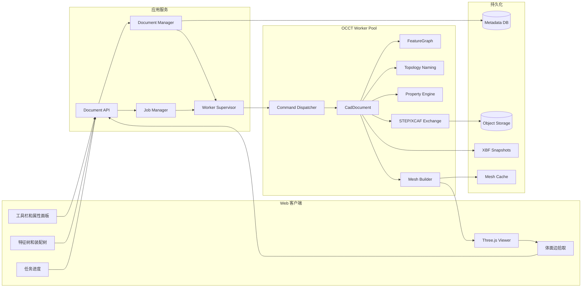

# OCCT Web 几何建模平台开发计划

> 文档状态：规划基线\
> 适用项目：`web-cad-demo` 及其后续产品化工程\
> 几何内核：Open CASCADE Technology 8.0\
> 最后更新：2026-07-14

## 1. 文档目的

本文档用于指导当前 Demo 向可持续开发的 Web 几何建模平台演进，统一产品范围、系统架构、数据模型、开发阶段、验收标准和技术风险。

当前确认的核心需求如下：

1. 暂不实现二维参数化草图和约束求解。
2. 支持历史式三维参数化特征建模，即特征参数可以修改，下游特征能够按依赖关系重新计算。
3. 支持常规三维直接建模，包括基本体、变换、布尔、圆角、倒角、抽壳、偏移、拔模、阵列等。
4. 支持 STEP/STP 文件导入和导出。
5. 支持给 Body、Face、Edge 设置类型化用户属性。
6. 用户属性必须随文档保存，并在建模导致拓扑变化时按照明确规则传播、冲突或失效。
7. 浏览器负责交互和显示，服务端原生 OCCT 负责权威 BRep 几何计算。

## 2. 产品范围

### 2.1 V1 必须支持

- 多文档、单文档多 Body。
- Box、Cylinder、Cone、Sphere、Torus、Wedge。
- Translate、Rotate、Mirror、Scale。
- Boolean Fuse、Cut、Common。
- Fillet、Chamfer。
- Shell、Thicken、Offset、Draft。
- Linear Pattern、Circular Pattern、Mirror Feature。
- Split、Section。
- 面积、体积、重心、包围盒、距离和角度测量。
- 特征树、特征参数修改、下游自动重算。
- 特征删除、抑制、恢复、撤销和重做。
- 体、面、边拾取和高亮。
- Body、Face、Edge 用户属性 CRUD 和批量编辑。
- STEP/STP 导入导出。
- STEP 装配树、名称、颜色、图层、材料和单位的读取与尽可能保留。
- XBF 内部文档快照。
- Worker 超时、取消、崩溃恢复和错误诊断。

### 2.2 V1 后续增强

- Revolve。
- Sweep、Pipe。
- Loft。
- 预定义圆、矩形、椭圆和多边形截面。
- 3D Wire 或导入 Wire 作为 Sweep、Loft、Revolve 的输入。
- Shape Healing 和人工修复工具。
- 大模型分块、LOD 和渐进加载。
- 装配干涉检查。
- 用户属性搜索、过滤和可视化着色。
- 参数表达式，例如 `R = thickness * 0.5`。

### 2.3 明确不在当前范围

- 二维参数化草图。
- 几何和尺寸约束求解器。
- 从 STEP 自动恢复原 CAD 软件的特征历史。
- 装配约束求解。
- 实时多人协同编辑。
- PMI/GD&T 编辑器。
- 工程图、CAM 和有限元求解。
- 完整替代成熟商业 CAD 软件。

## 3. 初始 Demo 基线（阶段 0）

当前 Demo 已经验证：

- C++ OCCT Worker 可以创建 Box。
- Worker 可以执行单边 Fillet。
- BRep 可以三角化并返回浏览器。
- 浏览器可以显示模型，并具备 Body、Face、Edge 拾取实现。
- 三角形可以映射回 Face，独立边折线可以映射回 Edge。
- revision 可以阻止旧拓扑 ID 被继续使用。
- 本地 Node 网关可以管理常驻几何 Worker。
- 类型检查、前端构建、页面渲染和几何 API 回归测试已经建立。

当前 Demo 的主要限制：

- Worker 只维护一个内存 `TopoDS_Shape`。
- 文本协议只有 `BOX` 和 `FILLET`。
- 没有多文档、多 Body 和 FeatureGraph。
- 没有 XCAF/OCAF 文档。
- 没有持久化、撤销重做和任务系统。
- 拓扑 ID 只在当前 revision 内有效。
- 没有用户属性。
- 没有 STEP 读写。

因此，下一阶段不能继续在单一 `ModelSession` 中堆积命令，应先完成文档内核重构。

### 3.1 当前实现进度（2026-07-13）

已完成：

- Worker 升级为版本化 JSON Lines 协议，支持多文档。
- 已实现 `CadDocument`、多 Body、FeatureGraph、XCAF/OCAF 和 XBF 快照。
- Box、Fillet、Boolean Fuse/Cut/Common 已写入几何操作树。
- Body、Face、Edge 已支持 `string`、`integer`、`real`、`boolean` 类型用户属性的设置、查询和删除。
- 文档 revision 与 Body topology revision 已分离，纯属性修改不会让拾取 ID 失效。
- Fillet 和 Boolean 已接入 OCCT `Modified/Generated/IsDeleted` 历史：支持一对一迁移、分裂复制、删除失效和多来源值冲突标记。
- 用户属性、特征历史和几何均可通过 XBF 保存及恢复。
- Web 界面已增加几何操作树和所选 Body/Face/Edge 的用户属性编辑器。
- 已实现 STEP/STP 二进制上传、XCAF 导入、STEP 导出下载；导入实体会生成 `ImportSTEP` 特征并可继续 Fillet。
- 已建立属性类型校验、旧 revision、错误拓扑引用、属性传播、Boolean、XBF 和 STEP 往返测试。

- 已实现 `primitive.cylinder`、`primitive.cone`、`primitive.sphere`、`primitive.torus`，均写入多 Body 文档和几何操作树。
- 已实现 `transform.translate`；Face/Edge 用户属性通过 OCCT 变换历史迁移到新拓扑版本。
- Web 界面已提供基础体创建和平移面板，并显示真实文档 Body 数量与最新 revision。
- 已建立 `Box + translated Cylinder -> Boolean Cut` 贯穿孔回归测试，覆盖属性传播与结果有效性。
- 已实现 `transform.rotate`、`transform.mirror`、`transform.scale`，支持自定义原点、轴/法向和统一缩放因子。
- Rotate、Mirror、Scale 均复用 OCCT 拓扑历史映射，连续变换后的 Face/Edge 用户属性仍可追踪。
- Web 多 Body Boolean 面板已支持选择 Target/Tool、Fuse/Cut/Common 和 `keepTool`。
- 已实现 `feature.update`：可修改 Box/Cylinder/Cone/Sphere/Torus、Translate/Rotate/Mirror/Scale 和 Fillet 数值参数，并按 FeatureGraph 依赖顺序原子重放。
- 原生 Primitive/Transform/Fillet/Boolean 依赖图已支持重算，包括被 Boolean 消耗的 Tool Body 重建；无关分支不会提交修改。Primitive/Transform 同构链继续迁移 Face/Edge 属性，经过 Fillet/Boolean 的复杂拓扑则保留 Body 属性，并将 Face/Edge 属性标记为待重新指定，避免错误绑定。
- Gateway 已实现最多 50 步的持久化 Undo/Redo 状态图：每个文档保存 `current + undo[] + redo[]` 不可变 XBF 检查点和原子 JSON 清单，服务重启时恢复当前模型与历史位置；失败命令不会进入历史。
- XBF 检查点写入 SHA-256 校验值；当前检查点损坏时启动流程跳过该文件并回退到最近可读 Undo/Redo 状态，无法恢复时返回明确历史警告。
- 同一文档的写操作通过 Gateway 串行队列执行，避免并发请求交错提交几何状态与历史清单。
- Web 页面启动时先读取 `document.view`，显示恢复文档；仅在空文档时创建默认 Box。
- ImportSTEP 已保存受控本地 `sourcePath`，重算会在临时 XCAF 文档中重新读取来源并映射全部导入 Body；Gateway 重启后仍可重放。来源缺失、解析失败或 Body 数量变化会返回明确错误并保持当前模型不变。
- Web 特征树下方已提供 Primitive、Transform、Fillet 参数编辑、依赖重算、撤销和重做控件。
- 直接 Fillet 与重算 Fillet 均增加了基于 Body 包围盒的保守半径预检查，极端半径返回可恢复的参数错误，避免 OCCT 进程崩溃。
- Web 工作台已重构为 HFSS/AEDT 风格的桌面布局：顶部菜单和功能区、左侧工程/特征树、中央 3D 视口、右侧建模/属性/历史检查器、底部消息和状态区。
- 视口采用无投影的 CAD 着色模式；实体不参与阴影贴图，面选择覆盖层关闭深度写入并使用 polygon offset，避免低视角下出现自阴影和共面闪烁。
仍待实现：

- 面向审计/协作的追加式命令日志；当前持久化的是可恢复状态图，不是完整审计日志。
- STEP 装配树、颜色、名称、图层、材料和单位的系统化验收。
- 自定义用户属性的 STEP Sidecar 导出包与恢复。

## 4. 核心架构决策

### 4.1 权威计算位置

权威 BRep 几何始终由服务端原生 OCCT Worker 计算。浏览器中的 Three.js 网格只用于显示、预览和拾取，不作为精确几何源数据。

### 4.2 权威数据划分

| 数据 | 权威来源 | 说明 |
|---|---|---|
| 参数化建模语义 | FeatureGraph | 特征、参数、输入依赖、顺序和状态 |
| 精确几何和装配 | XCAF/OCAF 文档 | Body、Shape、装配、标准 CAD 属性和拓扑标签 |
| 用户属性 | XCAF Label 上的类型化属性 | Body、Face、Edge 属性随 XBF 保存 |
| 项目、用户、任务元数据 | 数据库 | 文档索引、权限、任务、审计，不存权威 BRep |
| 显示网格 | 可丢弃缓存 | 可由精确几何重新生成 |
| STEP 文件 | 交换产物 | 不是平台内部权威文档 |

### 4.3 参数化的定义

本项目中的“参数化”是：

```text
建模操作 + 操作参数 + 输入依赖 + 历史顺序 + 拓扑引用 + 自动重算
```

它不等同于二维草图，也不只是全局变量。第一阶段特征参数使用直接数值；表达式和全局变量可在 V1 后增加。

### 4.4 STEP 的定位

- STEP 是交换格式，不是内部编辑格式。
- STEP 导入后生成一个 `ImportSTEP` 特征，后续可以继续添加 Boolean、Fillet、Chamfer 等特征。
- STEP 通常没有原始特征历史，平台不承诺恢复原草图、拉伸和阵列结构。
- 内部完整保存使用 XBF 加 FeatureGraph。

## 5. 总体系统架构



## 6. 组件职责

### 6.1 Web 客户端

- 三维场景、相机和显示模式。
- Body、Face、Edge 拾取。
- 特征创建、参数修改和错误展示。
- 特征树和装配树。
- 用户属性面板和批量编辑。
- STEP 上传、导出和异步任务进度。
- 只持有当前 revision 的显示 ID，不保存永久拓扑身份。

建议前端模块：

```text
app/cad/
├─ api/
├─ document/
├─ feature-tree/
├─ assembly-tree/
├─ properties/
├─ jobs/
└─ viewer/
   ├─ scene/
   ├─ selection/
   ├─ highlighting/
   └─ mesh-loader/
```

### 6.2 应用服务

- HTTP/WebSocket API。
- 身份、权限、文档锁和 revision 校验。
- 文档到 Worker 的路由。
- STEP 导入导出任务管理。
- 上传限制、临时文件和下载。
- Worker 崩溃监控和恢复。
- 不直接实现几何算法。

### 6.3 OCCT Worker

- 维护 `CadDocument`。
- 执行 Feature 命令。
- 维护 FeatureGraph、XCAF、拓扑引用和用户属性。
- 验证输入和结果 Shape。
- 网格化并生成拾取映射。
- STEP/XCAF 导入导出。
- 每个文档内命令串行执行。

### 6.4 持久化

- FeatureGraph 使用版本化 JSON 或数据库记录保存。
- XCAF 文档保存为 XBF 快照。
- STEP、XBF、网格和导出包放入对象存储。
- 数据库只保存文档元数据、任务、权限和对象存储引用。
- 每次成功事务后保存操作日志；按操作数或时间生成快照。

## 7. 目标代码结构

```text
web-cad-demo/
├─ app/
│  └─ cad/
├─ gateway/
│  ├─ api/
│  ├─ documents/
│  ├─ jobs/
│  └─ workers/
├─ geometry-worker/
│  ├─ include/
│  ├─ src/
│  │  ├─ protocol/
│  │  ├─ document/
│  │  ├─ features/
│  │  ├─ topology/
│  │  ├─ properties/
│  │  ├─ exchange/
│  │  └─ presentation/
│  └─ tests/
├─ test-data/
│  ├─ step/
│  └─ brep/
└─ docs/
```

建议 C++ 类：

```text
CadDocument
DocumentManager
DocumentTransaction
FeatureGraph
FeatureNode
FeatureExecutor
TopologyReference
TopologyNamingService
UserProperty
PropertyStore
PropertyPropagationEngine
MeshBuilder
SelectionRegistry
StepImporter
StepExporter
WorkerCommandDispatcher
```

## 8. 文档和 FeatureGraph 模型

### 8.1 CadDocument

```text
CadDocument
├─ documentId
├─ revision
├─ TDocStd_Document / XCAF
├─ FeatureGraph
├─ Body Registry
├─ Topology Registry
├─ Property Store
├─ Undo/Redo Log
└─ Mesh Cache Metadata
```

### 8.2 FeatureNode

```json
{
  "id": "feature-4",
  "type": "detail.fillet",
  "enabled": true,
  "inputs": {
    "body": "feature-3",
    "edges": ["topology-ref-12"]
  },
  "parameters": {
    "radius": 5.0
  },
  "state": "valid",
  "outputBodies": ["body-4"],
  "computedRevision": 18,
  "error": null
}
```

Feature 状态：

```text
clean
dirty
computing
valid
failed
suppressed
blocked_by_upstream
```

### 8.3 重算规则

1. 修改特征参数。
2. 对当前特征和所有下游特征标记 `dirty`。
3. 按拓扑排序重新执行。
4. 每一步记录 `Modified`、`Generated`、`Deleted` 历史。
5. 更新拓扑引用和用户属性。
6. 检查 Shape 有效性。
7. 失败时停止相关下游分支，保留最后一个成功快照。
8. 全部成功后原子提交 revision。

## 9. 特征分类和实现顺序

### 9.1 基本体

```text
primitive.box
primitive.cylinder
primitive.cone
primitive.sphere
primitive.torus
primitive.wedge
```

### 9.2 变换

```text
transform.translate
transform.rotate
transform.mirror
transform.scale
```

### 9.3 布尔

```text
boolean.fuse
boolean.cut
boolean.common
boolean.section
```

### 9.4 细节特征

```text
detail.fillet
detail.chamfer
detail.shell
detail.thicken
detail.offset
detail.draft
detail.split
```

### 9.5 阵列和高级特征

```text
pattern.linear
pattern.circular
pattern.mirror
sweep.revolve
sweep.pipe
sweep.loft
```

不做二维草图时，高级特征的截面来源限定为：

- 预定义截面。
- 现有平面 Face 的外边界 Wire。
- 3D Wire。
- STEP/BREP 导入曲线。

## 10. 拓扑身份与命名

### 10.1 两类 ID

显示 ID：

```text
body-18-1
face-18-12
edge-18-8
```

- 只在当前 revision 内有效。
- 用于浏览器显示和拾取。
- 不能保存到 FeatureGraph 或用户属性中作为永久引用。

稳定拓扑引用：

```json
{
  "id": "topology-ref-12",
  "sourceFeature": "feature-3",
  "shapeType": "edge",
  "semantic": "generated-intersection-edge",
  "historyPath": [],
  "geometrySignature": {
    "curveType": "circle",
    "length": 62.831853,
    "center": [50, 40, 25]
  },
  "adjacencySignature": {}
}
```

### 10.2 解析顺序

```text
特征语义
→ OCCT Modified/Generated/Deleted 历史
→ OCAF/TNaming
→ 几何和邻接签名回退
→ 无法唯一解析时明确失败
```

禁止在无法唯一解析时静默选择“最相似”的另一条边或另一个面。

## 11. Body、Face、Edge 用户属性

### 11.1 存储方案

- Body 使用 XCAF Shape Label。
- Face、Edge 使用 `XCAFDoc_ShapeTool::AddSubShape()` 创建 SubShape Label。
- Label 上使用 `TDataStd_NamedData` 保存类型化属性。
- XBF 是属性完整保真的内部持久化格式。
- 数据库可以建立属性搜索索引，但不是属性权威来源。

### 11.2 属性模型

```json
{
  "key": "manufacturing.roughness",
  "displayName": "表面粗糙度",
  "type": "real",
  "value": 1.6,
  "unit": "um",
  "kind": "metadata",
  "propagation": "modified",
  "exportPolicy": "sidecar",
  "source": "user"
}
```

支持类型：

```text
string
integer
real
boolean
string[]
integer[]
real[]
json
```

命名空间：

```text
system.*
cad.*
user.*
manufacturing.*
simulation.*
```

### 11.3 几何参数与用户属性分离

- `Box.length`、`Fillet.radius` 是几何参数，修改后触发 FeatureGraph 重算。
- `user.name`、`manufacturing.roughness` 是元数据，修改后只产生文档事务，不触发几何重算。
- 后续若需要属性驱动几何，必须通过显式参数绑定实现，不允许任意元数据隐式进入几何表达式。

### 11.4 属性传播规则

| 拓扑变化 | 默认处理 |
|---|---|
| Shape 保持 | 保留属性 |
| Modified 一对一 | 复制到新 Shape |
| Modified 一对多 | 复制到所有分裂结果，并标记继承来源 |
| Generated | 默认不继承 |
| 多对一合并且值相同 | 保留值 |
| 多对一合并且值不同 | 生成属性冲突 |
| Deleted | 属性进入孤立/失效列表 |
| 无法唯一匹配 | 标记待确认，不自动猜测 |

传播策略：

```text
none
modified
generated
all_descendants
manual
```

推荐默认值：

- Body、名称和普通工艺属性：`modified`。
- Face、Edge 普通用户属性：`modified`。
- 仿真载荷和边界条件：`manual`。
- 临时显示属性：
one`。

### 11.5 属性 API

```http
GET    /api/documents/{documentId}/entities/{entityId}/properties
PUT    /api/documents/{documentId}/entities/{entityId}/properties/{key}
DELETE /api/documents/{documentId}/entities/{entityId}/properties/{key}
POST   /api/documents/{documentId}/properties/batch
GET    /api/documents/{documentId}/property-conflicts
GET    /api/documents/{documentId}/orphan-properties
```

每次属性写操作必须携带 `baseRevision`，纳入撤销重做和审计记录。

## 12. STEP 导入导出架构

### 12.1 技术选择

- 使用 `DE_Wrapper` 和 XCAF 文档作为首选入口。
- 使用 `DESTEP_Parameters` 的任务级独立实例或 Wrapper 副本。
- 使用 `STEPCAFControl_Reader/Writer` 作为需要精细控制时的下层接口。
- 单 Shape 简化场景才考虑 `STEPControl_Reader/Writer`。

### 12.2 导入流程

```text
上传文件
→ 文件名、大小和扩展名校验
→ 保存受控临时文件
→ 创建异步导入任务
→ 隔离 Worker 读取到 XCAF
→ 单位和容差标准化
→ Shape 检查与 Healing
→ 提取装配、名称、颜色、图层和材料
→ 创建 ImportSTEP Feature
→ 网格化和装配树生成
→ 保存 XBF 快照
→ 原子提交文档 revision
```

### 12.3 导出流程

```text
确保 FeatureGraph 重算成功
→ 验证 Body 和装配
→ 写入 XCAF 标准 CAD 属性
→ STEP 导出任务
→ 校验导出文件
→ 生成下载对象
```

### 12.4 自定义用户属性导出

任意 `TDataStd_NamedData` 用户属性不保证被标准 STEP Writer 自动保存。导出策略分为：

```text
standard  映射为 STEP 支持的名称、颜色、图层、材料等
sidecar   导出 STEP + properties.json
internal  只保存在 XBF 内部文档
```

完整保真交换包：

```text
model-package.zip
├─ model.step
├─ properties.json
└─ manifest.json
```

### 12.5 STEP API

```http
POST /api/documents/{documentId}/imports/step
POST /api/documents/{documentId}/exports/step
GET  /api/jobs/{jobId}
POST /api/jobs/{jobId}/cancel
GET  /api/exports/{exportId}/download
```

## 13. 命令协议

当前文本协议应升级为带版本的 JSON Lines 或本地 IPC 协议：

```json
{
  "protocolVersion": 1,
  "requestId": "req-25",
  "documentId": "doc-1",
  "baseRevision": 18,
  "operation": "boolean.cut",
  "inputs": {
    "targetBody": "body-feature-3",
    "toolBody": "body-feature-4"
  },
  "parameters": {}
}
```

成功结果：

```json
{
  "ok": true,
  "requestId": "req-25",
  "documentId": "doc-1",
  "revision": 19,
  "changedBodies": ["body-5"],
  "invalidatedTopology": [],
  "propertyConflicts": [],
  "warnings": []
}
```

失败结果：

```json
{
  "ok": false,
  "requestId": "req-25",
  "code": "TOPOLOGY_REFERENCE_AMBIGUOUS",
  "message": "Selected edge cannot be resolved uniquely after recompute.",
  "featureId": "feature-8",
  "details": {}
}
```

错误码必须稳定，前端不能通过匹配英文错误文本判断业务状态。

## 14. 并发和 Worker 模型

- 单个文档同一时刻只允许一个写命令。
- 不同文档可以分配到不同 Worker 并行计算。
- STEP 导入导出使用独立任务 Worker，避免阻塞交互建模。
- 每个命令携带 `baseRevision`。
- Worker 超时或崩溃后从最近 XBF 快照和操作日志恢复。
- 高风险或不受信任文件解析必须放在隔离进程中。
- 不允许多个线程共享可变的 STEP 全局参数。

## 15. 安全和资源限制

- 上传文件大小、扩展名和内容类型限制。
- 临时目录随机化，禁止路径穿越。
- STEP/BREP 文件解析超时。
- Worker 内存和 CPU 时间限制。
- 文档最大 Body、Face、Edge 和三角形数量限制。
- 单文档命令队列长度限制。
- 用户属性 key、类型、长度、数量和数组大小限制。
- JSON 属性禁止无限嵌套和超大对象。
- 所有导出下载使用短期授权地址。
- 日志不得写入用户文件内容和敏感属性值。

## 16. 开发阶段和时间计划

以下估算基于 5～6 人团队：2 名 C++/OCCT、1～2 名前端、1 名后端、1 名测试/产品。总周期约 22～26 周。

### 阶段 0：需求和测试基线，第 1 周

任务：

- 冻结 V1 功能矩阵和非目标。
- 定义 Feature、Property、TopologyReference Schema。
- 收集 STEP 测试集。
- 定义几何和 STEP 验收指标。
- 为现有 Demo 保留回归测试。

交付：

- 架构决策记录。
- API 和 Schema 草案。
- 至少 20 个 STEP/BREP 测试模型。

阶段门槛：所有 V1 功能具有输入、输出、失败条件和验收用例。

### 阶段 1：文档内核，第 2～4 周

任务：

- 拆分当前 `ModelSession`。
- 实现 `CadDocument`、`DocumentManager`、事务和 revision。
- 接入 XCAF/OCAF。
- 支持多 Body。
- 建立 FeatureGraph 基础。
- 将 Box 和 Fillet 改造成 Feature。
- 实现 JSON 命令协议和稳定错误码。
- 实现 XBF 快照。

验收：

- 同一 Worker 可以打开、关闭和恢复多个文档。
- 一个文档可以包含多个 Body。
- 修改 Box 参数后下游 Fillet 自动重算。
- 旧 revision 请求被拒绝。
- XBF 保存和恢复几何一致。

### 阶段 2：用户属性和拓扑基础，第 5～8 周

任务：

- Body、Face、Edge Label 映射。
- `TDataStd_NamedData` 属性存储。
- 属性 CRUD、批量编辑和事务。
- TopologyReference 初版。
- Modified、Generated、Deleted 历史采集。
- 属性传播、冲突和孤立属性模型。
- 前端属性面板。

验收：

- 三类拓扑对象均可设置和读取属性。
- XBF 往返后属性不丢失。
- Box 参数修改后顶部 Face 属性仍指向顶部 Face。
- Fillet 删除 Edge 后，其属性进入失效列表。
- Face 分裂时属性按规则传播。
- 多对一且值不同时产生可见冲突。

阶段门槛：属性传播必须“正确、冲突或失效”，禁止静默绑错拓扑。

### 阶段 3：STEP 纵向链路，第 9～12 周

任务：

- 接入 DE Wrapper、XCAF STEP 工具包。
- 上传和异步任务 API。
- 单零件和装配导入。
- 名称、颜色、图层、材料、单位读取。
- 装配树和渐进网格。
- STEP 导出。
- STEP + 属性 Sidecar 包。
- 导入隔离、超时和取消。

验收：

- `.stp`、`.step` 导入成功。
- 至少三级装配结构正确显示。
- 名称、颜色和单位正确。
- 导入零件可继续执行 Fillet 或 Boolean。
- 导出 STEP 可被外部 CAD 打开。
- STEP 往返前后装配层级和几何质量满足基线。
- 自定义属性通过 XBF 或 Sidecar 完整恢复。

阶段门槛：带装配和颜色的 STEP 纵向往返稳定后，才批量扩充建模功能。

### 阶段 4：基础直接建模，第 13～16 周

任务：

- 所有基本体。
- Translate、Rotate、Mirror、Scale。
- Fuse、Cut、Common、Section。
- Body 管理。
- 测量和 Shape 有效性检查。
- 参数编辑和依赖重算。

验收场景：

```text
Box + Cylinder
→ Boolean Cut 打孔
→ 修改 Cylinder 半径
→ Cut 自动重算
→ Body/Face/Edge 属性保持或明确变化
→ 导出 STEP
```

### 阶段 5：细节特征和拓扑稳定性，第 17～21 周

任务：

- Fillet、Chamfer。
- Shell、Thicken、Offset、Draft。
- Split。
- 拓扑命名强化。
- 特征删除、抑制、恢复。
- 撤销、重做。
- 大规模拓扑和属性传播回归测试。

验收：

- 上游参数修改后，下游特征正确重算或明确失败。
- 不发生属性静默错绑。
- 失败特征不会污染最后成功快照。
- 撤销和重做后几何、特征树和属性一致。

### 阶段 6：阵列、高级特征和生产加固，第 22～26 周

任务：

- Linear、Circular、Mirror Pattern。
- 根据优先级实现 Revolve、Sweep、Loft。
- Worker 池、超时、取消和崩溃恢复。
- 网格缓存、分块和性能优化。
- 日志、指标、审计和安全测试。
- 浏览器兼容和部署方案。

验收：

- 常规零件建模用例完整通过。
- STEP 大文件和异常文件测试通过。
- Worker 崩溃后文档可恢复。
- 性能指标达到第 18 节目标。

## 17. 并行开发安排

| 工作流 | 主要负责人 | 开始阶段 |
|---|---|---|
| XCAF、FeatureGraph、几何算法 | C++/OCCT | 阶段 1 |
| 拓扑命名和属性传播 | C++/OCCT | 阶段 2 |
| STEP 导入导出 | C++/OCCT + 后端 | 阶段 2 后半 |
| 文档 API、任务和 Worker 管理 | 后端 | 阶段 1 |
| Viewer、特征树和属性 UI | 前端 | 阶段 1 |
| 测试模型和自动化 | 测试 | 阶段 0 |

前端不应等待所有几何算法完成。每个 Feature 使用固定 JSON Contract 和模拟数据并行开发，随后接入真实 Worker。

## 18. 性能和可靠性目标

- 相机和普通交互目标 60 FPS。
- 20 万三角形首次显示小于 3 秒。
- 50 万三角形模型保持可操作。
- 简单 Feature P95 小于 500 毫秒。
- 常规 Boolean、Fillet P95 小于 2 秒。
- 超过 2 秒的操作必须显示进度并允许取消。
- STEP 导入任务不得阻塞普通文档命令。
- Worker 异常不能丢失最近成功提交的文档。
- 同一命令、相同输入和相同内核版本应得到可重复结果。

## 19. 测试策略

### 19.1 C++ 单元测试

- 每个 Feature 的合法、边界和非法输入。
- FeatureGraph 拓扑排序和脏标记传播。
- TopologyReference 解析。
- 属性存储、传播、冲突和孤立。
- STEP 参数和单位转换。

### 19.2 文档集成测试

- 创建、保存、关闭、恢复。
- 多 Body。
- 参数修改和下游重算。
- 撤销重做。
- XBF 往返。
- Worker 崩溃恢复。

### 19.3 拓扑和属性回归

必须包含：

1. Body 属性随参数修改保留。
2. 顶部 Face 属性在 Box 高度变化后仍定位正确。
3. Edge 被 Fillet 删除后属性进入失效列表。
4. Face 被 Boolean 分裂后属性传播到所有结果。
5. 多 Face 合并且值不同时产生冲突。
6. 撤销 Boolean 后原属性恢复。
7. 无法唯一解析时操作失败而不是错绑。

### 19.4 STEP 测试

- 单实体。
- 多实体。
- 多级装配。
- 名称和颜色。
- 不同单位。
- 大文件。
- 坏文件和截断文件。
- 小边、缝隙、非流形和异常容差。
- 导入、修改、导出、重新导入的完整往返。

### 19.5 前端测试

- Body、Face、Edge 拾取。
- revision 更新后清除旧选择。
- 特征树状态和错误。
- 属性 CRUD、批量编辑和冲突处理。
- STEP 上传、进度、取消和下载。
- 大模型和窗口尺寸变化。

## 20. 质量门槛

任何 Feature 合入前必须满足：

- 有明确 JSON Contract。
- 有成功、失败和边界测试。
- 检查 OCCT `IsDone` 和结果 Shape 有效性。
- 记录拓扑历史。
- 定义用户属性传播行为。
- 支持取消或受超时保护。
- 错误使用稳定错误码。
- 不允许修改失败后保留半提交文档。

任何 STEP 功能合入前必须满足：

- 使用独立任务参数。
- 有文件大小和超时限制。
- 在隔离 Worker 中运行。
- 临时文件可清理。
- 有外部 CAD 可打开性验证。

## 21. 风险清单和缓解措施

| 风险 | 影响 | 缓解措施 |
|---|---|---|
| 拓扑命名不稳定 | 下游特征或属性绑错 | 历史、TNaming、语义和签名多级解析；歧义即失败 |
| Fillet、Shell、Offset 对复杂输入失败 | 建模成功率下降 | 明确算法限制、预检查、可诊断错误和测试模型库 |
| STEP 文件质量差 | 导入失败或容差膨胀 | 隔离任务、Healing、质量报告和原始文件保留 |
| 自定义属性无法进入标准 STEP | 数据丢失 | XBF 权威保存，STEP + Sidecar 完整导出 |
| FeatureGraph 和 XCAF 双重状态不一致 | 文档损坏 | 单事务提交、快照校验和恢复测试 |
| 大模型网格过大 | 浏览器卡顿 | 网格缓存、分块、LOD、按装配节点加载 |
| Worker 崩溃 | 文档丢失 | 单文档命令日志、周期快照、Supervisor 自动恢复 |
| 功能范围持续膨胀 | 交付延期 | 功能矩阵、阶段门槛和非目标清单 |

## 22. 团队建议

标准配置：

- 2 名 C++/OCCT 几何开发。
- 1～2 名 Web 三维前端开发。
- 1 名后端/平台开发。
- 1 名测试工程师。
- 1 名 CAD 产品或几何负责人，可由资深 C++ 开发兼任。

预计周期：

- 5～6 人：22～26 周。
- 3～4 人：7～9 个月。
- 2 人：9～12 个月，并应进一步削减高级特征范围。

## 23. 首个两周迭代

### 第 1 周

- 建立目标目录结构。
- 定义 JSON 命令协议和错误码。
- 实现 `CadDocument`、`DocumentManager` 和事务骨架。
- 初始化 XCAF 文档。
- 实现多 Body Registry。
- 将现有 Box 封装为 `PrimitiveBoxFeature`。
- 将现有 Fillet 封装为 `FilletFeature`。
- 建立 C++ 测试入口。

### 第 2 周

- 实现 XBF 保存和恢复。
- 创建 Body、Face、Edge Label 映射。
- 实现最小类型化用户属性 CRUD。
- 建立初版 TopologyReference。
- 修改 Box 参数并验证下游 Fillet 重算。
- 验证 Face 属性随 Box 参数修改保留。
- 更新前端以显示 FeatureTree 和属性面板最小版本。

两周验收：

```text
创建文档
→ 创建 Box
→ 给 Body、Face、Edge 设置属性
→ 创建 Fillet
→ 修改 Box 参数
→ 重算并检查属性
→ 保存 XBF
→ 关闭并重新打开
→ 几何、特征树和属性一致
```

## 24. 后续阶段启动条件

开始 STEP 阶段前：

- XCAF 文档和 XBF 往返稳定。
- Body、Face、Edge 属性存储完成。
- FeatureGraph 能执行最小重算。

开始批量建模功能前：

- STEP 装配纵向导入导出通过。
- 拓扑引用和属性传播有回归测试。
- 文档事务和失败回滚稳定。

进入生产加固前：

- V1 功能矩阵全部有自动化测试。
- 不存在已知的静默拓扑错绑。
- STEP 异常文件不能使主服务崩溃。

## 25. Definition of Done

V1 完成必须同时满足：

- 用户可以创建和编辑多 Body 三维模型。
- V1 特征均可修改参数并重算。
- Body、Face、Edge 可以设置、查询、删除和批量编辑用户属性。
- 属性随几何变化能够正确传播、冲突或失效。
- STEP 单零件和装配可以导入、修改和导出。
- XBF 能完整保存 FeatureGraph 对应快照、装配和用户属性。
- 撤销重做后几何、特征树和属性一致。
- Worker 失败能够恢复最近成功文档。
- 性能和安全指标达到本文档基线。
- 所有阶段门槛和回归测试通过。

---

本计划是当前产品范围的开发基线。新增二维草图、装配约束、PMI 编辑或实时协同时，应先更新本文档的范围、架构和工期，再进入实现。
