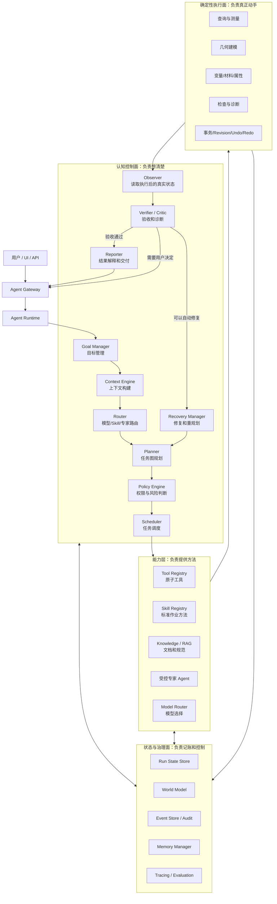
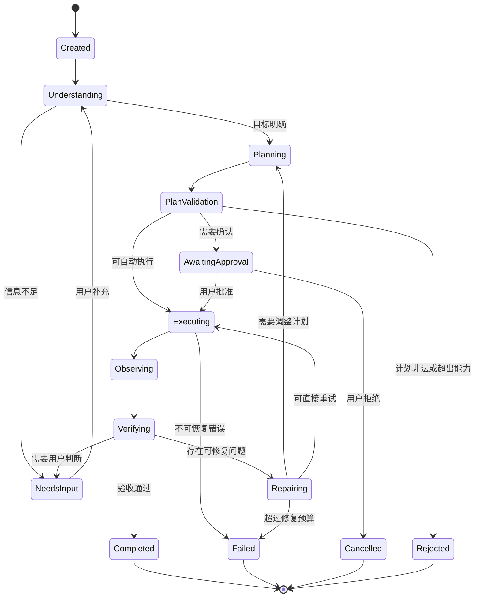

# 建模智能体目标架构设计（通俗详解）

> 文档定位：从零设计一个完整、稳定、强大的工程建模 Agent。
>
> 当前范围：负责几何建模、参数化建模、变量、坐标系、材料、自定义属性、模型查询、测量、检查和修改；暂不讨论网格、求解、后处理等仿真执行环节。
>
> 物理问题信息不再单独设计另一套模型，而是使用现有的“自定义属性类型 + 材料 + 对象属性”体系承载。

## 0. 先把工程边界说清楚：这是 Harness，但不只有 Harness

这份方案描述的是一个完整的“建模智能体平台”。它的核心确实是 Agent Harness，但完整产品应拆成三部分：

~~~text
完整建模智能体平台
├─ Agent Harness
│  └─ 通用运行底座：目标、计划、上下文、调度、权限、记忆、恢复、评测
├─ Modeling Domain Pack
│  └─ 建模领域能力：CAD 世界模型、Tool、Skill、属性、语义引用、验证规则
└─ Product Host
   └─ 产品外壳：UI、Gateway、用户、项目、文档、文件和外部接口
~~~

可以用汽车来类比：

- Agent Harness 是底盘、传动、制动和行车电脑。
- Modeling Domain Pack 是针对建模工作的专用上装和工具设备。
- Product Host 是驾驶舱、车门、仪表盘和对外服务入口。

Harness 不应该直接知道 TopoDS_Face、Boolean Cut 或某个属性类型的业务细节。它只应该知道：

- 当前有一个目标。
- 目标可以拆成任务和动作。
- 某个动作需要调用一项能力。
- 该能力有输入、输出、权限、风险和版本。
- 执行后需要观察和验收。
- 失败时需要恢复、重试或升级人工处理。

建模领域包则负责告诉 Harness：

- 什么是 Body、Feature、Face 和 Edge。
- 如何创建、查询和修改几何。
- 如何解析“最上面的平面”这种语义引用。
- 如何读取和填写自定义属性。
- 怎样判断一次建模动作是否真正成功。

产品宿主负责告诉 Harness：

- 当前用户是谁。
- 正在操作哪个项目和文档。
- 用户拥有什么权限。
- 界面如何展示计划、预览、审批和结果。
- 文件、密钥和外部连接如何管理。

这个边界非常重要。边界分清以后，未来增加网格、求解、文档处理或数据分析能力时，只需要增加新的 Domain Pack，不必重写 Harness。


## 1. 先说结论：这个 Agent 应该是什么

这个 Agent 不应该只是一个“能调用 CAD 命令的聊天机器人”。

更合适的定位是：

> 一个由大模型负责理解和思考、由状态机负责组织流程、由确定性工具负责真正修改模型、由验证器负责判断结果是否正确的虚拟建模总工程师。

可以把整个系统理解成一个工程团队：

- 用户是需求方，告诉系统想做什么。
- 主 Agent 是总工程师，负责理解目标、拆任务、安排工作和向用户汇报。
- Planner 是工艺工程师，负责决定先做什么、后做什么。
- Tool 是机床和量具，只做明确、具体的原子操作。
- Skill 是经过验证的标准作业指导书，例如“如何制作四孔安装板”。
- World Model 是当前工程的真实台账，记录模型现在到底是什么状态。
- Verifier 是质检员，不管过程说得多漂亮，只按实际结果验收。
- Policy Engine 是安全员，决定哪些动作可以自动执行，哪些必须先请示用户。
- Event Store 是工程日志，记录谁在什么时候做了什么，以及结果如何。

强大的 Agent 依靠的不是一个特别长的提示词，而是这套分工清楚、边界明确、可以恢复和验证的系统。

## 2. 为什么不能只做一个普通的 Tool Calling 循环

最简单的 Agent 通常是这样的：

```text
用户输入
→ 大模型选择一个工具
→ 工具执行
→ 结果返回大模型
→ 大模型继续选择工具
→ 结束
```

这种方式可以做 Demo，但很难成为成熟产品，主要问题有：

1. 大模型容易忘记最初目标，只顾着完成眼前一步。
2. 多步修改中途失败后，不知道应该回滚、重试还是改计划。
3. 工具返回“成功”不等于用户目标真的完成。
4. 浏览器刷新、服务重启或长时间暂停后，任务状态容易丢失。
5. 对话越长，上下文越乱，模型越容易引用过期对象。
6. 多个任务同时执行时，可能修改同一个文档并产生冲突。
7. 如果让多个子 Agent 自由协作，责任和写入顺序会更加混乱。

因此，成熟系统需要在 Tool Calling 外面增加一套“Agent 运行时”。大模型仍然重要，但它只是系统中的认知组件，不是整个系统本身。

## 3. 总体架构：三个平面

推荐把系统分成三个平面：认知控制面、确定性执行面、状态与治理面。



三个平面的职责可以用一句话区分：

- 认知控制面回答：“应该做什么，为什么这样做？”
- 确定性执行面回答：“具体怎么做，实际做成了什么？”
- 状态与治理面回答：“做到哪一步了，能否恢复，谁应该负责？”

## 4. 最重要的规则：大模型不能成为事实来源

大模型可以理解用户，也可以提出计划，但不能把自己的记忆当成 CAD 文档的真实状态。

例如，大模型记得“刚才创建了 body-3”，但用户可能已经手动撤销了操作，另一个任务也可能修改了文档。这时模型记忆已经过期。

因此系统必须坚持：

> 对话内容是线索，World Model 才是事实；工具返回是候选结果，重新查询和验证后的状态才是最终结果。

每次真正执行修改前，至少要重新确认：

- 当前 documentId。
- 当前 revision。
- 目标 Body、Feature、Face、Edge 是否仍然存在。
- 目标对象是否发生了变化。
- 计划依赖的变量、坐标系、材料和属性类型是否仍然有效。
- 当前用户是否仍然拥有对应权限。

## 5. Agent Runtime：整个系统的“大脑外壳”

Agent Runtime 不是模型，而是管理模型工作的程序。它负责维持一次任务从开始到结束的完整生命周期。

### 5.1 一次 Agent Run 是什么

用户的一次明确委托就是一个 Agent Run，例如：

> 创建一个 100×80×8 mm 的铝合金安装板，在四角开直径 10 mm 的孔，并给上表面填写 pressureLoad 类型属性。

这个 Run 不能只存在于内存里，而要持久化保存：

```text
AgentRun
├─ runId：本次任务唯一编号
├─ sessionId：所属对话
├─ documentId：操作哪个文档
├─ userGoal：用户最终想得到什么
├─ constraints：尺寸、材料、禁止事项等约束
├─ successCriteria：怎样才算完成
├─ autonomyPolicy：允许 Agent 自动做到什么程度
├─ baseRevision：开始规划时的文档版本
├─ goalGraph：目标和子目标
├─ planVersions：生成过的计划版本
├─ currentAction：正在执行哪一步
├─ observations：每一步实际观察到了什么
├─ verificationResults：质检结果
├─ pendingApprovals：正在等待哪些确认
├─ budgets：时间、调用次数、费用和重试预算
├─ status：当前状态
└─ finalOutcome：最终结果
```

### 5.2 Agent Run 状态机

建议使用明确的状态机，而不是靠某个布尔变量判断“忙不忙”。



状态机带来的直接好处是：

- 刷新页面后可以继续任务。
- 服务重启后可以知道停在了哪一步。
- 等待用户确认时不会丢失原始动作。
- 可以明确区分失败、取消和拒绝。
- 可以统计任务到底经常卡在哪个阶段。

## 6. Goal Manager：先弄清楚“到底要什么”

Goal Manager 相当于需求分析员。它的任务不是立即选择工具，而是把用户自然语言整理成明确目标。

一个好的目标对象至少包括：

```text
Goal
├─ objective：最终目标
├─ deliverables：要生成或修改哪些对象
├─ constraints：必须遵守的尺寸、单位和规则
├─ preferences：用户偏好，但不是硬约束
├─ exclusions：明确不要做什么
├─ assumptions：Agent 当前采用了哪些假设
├─ successCriteria：验收条件
└─ openQuestions：尚未解决的问题
```

例如用户说“做一个安装板”，信息通常不够。Goal Manager 应该识别：

- 板的长宽厚是多少？
- 孔的数量、直径和位置是多少？
- 使用绝对尺寸还是参数变量？
- 是否要指定材料？
- 是否要保留孔工具体？
- 模型原点放在哪里？

但也不能什么都问。系统需要把缺失信息分成三类：

1. 没有它就无法执行：必须询问。
2. 可以采用行业常用默认值：可以说明假设后继续。
3. 对最终结果影响很小：可以直接使用系统默认值。

Goal Manager 还要防止“目标漂移”。后续每次重规划都必须回到原始目标和成功标准，而不是只修复眼前报错。

## 7. World Model：Agent 看到的工程世界

World Model 是对当前建模文档的结构化描述。它不一定复制整个 CAD 文档，而是提供 Agent 可以查询的语义视图。

```text
ModelingWorld
├─ Document
│  ├─ documentId
│  ├─ revision
│  ├─ units
│  ├─ activeBody
│  └─ documentLocks
├─ EntityGraph
│  ├─ bodies
│  ├─ features
│  ├─ faces
│  ├─ edges
│  └─ dependencies
├─ ParameterModel
│  ├─ variables
│  ├─ expressions
│  └─ coordinateSystems
├─ PropertyModel
│  ├─ propertyTypeSchemas
│  ├─ materials
│  ├─ bodyProperties
│  ├─ faceProperties
│  ├─ edgeProperties
│  ├─ inheritanceRules
│  └─ provenance
├─ SelectionState
├─ Measurements
├─ ValidationState
└─ AvailableCapabilities
```

### 7.1 自定义属性类型在架构中的位置

现有自定义属性类型就是物理问题模型的基础，不需要再造一套平行体系。

Agent 需要能够理解以下信息：

- 属性类型可以绑定到 Body、Face 还是 Edge。
- 属性有哪些字段，每个字段是什么类型。
- 数值字段的单位和量纲是什么。
- 哪些字段必填，哪些字段有默认值。
- 数值允许的范围。
- 属性之间是否互斥或依赖。
- 属性来自用户、模板、材料还是 Agent 推断。
- 某个属性是否已经经过用户确认。

例如 pressureLoad 属性类型可以描述为：

```text
pressureLoad
├─ allowedTargets: Face
├─ fields
│  ├─ magnitude: Pressure，必填
│  ├─ directionMode: normal/vector，必填
│  ├─ vector: Vector3，仅 vector 模式需要
│  └─ coordinateSystem: Reference，可选
├─ validationRules
└─ displayRules
```

Agent 只负责按照 Schema 填写属性，不允许自己创造未注册字段，也不允许跳过单位检查。

### 7.2 对象引用不能只靠临时 ID

建模过程会不断改变拓扑。一个 Face ID 在圆角、布尔或重算后可能消失，也可能对应到另一张面。

因此 Agent 内部的 EntityReference 应该比 `face-1-3` 更丰富：

```text
EntityReference
├─ documentId
├─ revisionAtResolution
├─ entityKind
├─ stableId（如果有）
├─ owningBody
├─ featureLineage
├─ semanticQuery
├─ geometricSignature
│  ├─ area / length
│  ├─ centroid
│  ├─ normal / direction
│  ├─ curvatureType
│  └─ adjacency
├─ resolutionConfidence
└─ ambiguityCandidates
```

例如“安装板上表面”可以记录为：

```text
所属 Body = BasePlate
面类型 = Plane
法向接近 +Z
中心 Z 最大
面积接近 8000 mm²
来源 Feature = BaseExtrude
```

文档修改后，系统重新解析这个语义引用。如果只有一个高置信度结果，可以继续；如果出现两个相似候选面，就必须让用户确认。

## 8. Context Engine：每轮只给模型需要的信息

上下文越多不一定越好。把完整特征树、所有属性、所有历史消息和全部工具都塞给模型，反而会让模型更容易混淆。

Context Engine 每轮只需要回答四个问题：

1. 当前要完成什么目标？
2. 与当前步骤相关的模型状态是什么？
3. 当前允许使用哪些能力？
4. 过去有哪些经过确认的事实与本步骤相关？

建议每次构建一个 Context Pack：

```text
ContextPack
├─ systemPolicy：系统硬规则
├─ activeGoal：当前目标和验收标准
├─ activePlanSlice：当前步骤及前后依赖
├─ worldSlice：相关实体和属性，不是全量文档
├─ availableTools：本轮允许使用的少量工具
├─ selectedSkills：本轮适用的 Skill
├─ recentObservations：最近关键执行结果
├─ relevantMemory：经过筛选的项目记忆
├─ errors：需要处理的结构化错误
└─ budgets：剩余时间、调用和重试额度
```

### 8.1 动态工具暴露

不要每轮都给模型几百个 Tool。

例如：

- 目标理解阶段，只暴露查询和测量工具。
- 创建基础体阶段，只暴露变量、坐标系和基础体工具。
- 属性设置阶段，只暴露属性 Schema 查询、对象解析和属性写入工具。
- 修复阶段，只暴露诊断、撤销、几何检查和候选修复工具。

工具越少，模型选择错误的概率越低，也更容易做权限控制。

### 8.2 对话摘要不是事实

旧消息可以压缩成摘要，但摘要只能用于理解用户意图，不能代替 CAD 查询。

正确做法是：

```text
摘要说“用户创建过一个底板”
→ Agent 查询当前 Body 列表
→ 确认底板仍然存在
→ 再把真实对象引用交给 Planner
```

## 9. Planner：把目标变成可执行任务图

Planner 不应该一次输出几十个未经验证的 Tool Call。更稳定的方式是“分层规划 + 滚动展开”。

### 9.1 三层计划

第一层是目标计划：

```text
创建底板
→ 创建四个孔
→ 设置材料
→ 设置上表面属性
→ 验收
```

第二层是任务计划：

```text
创建四个孔
├─ 确定孔中心位置
├─ 创建四个圆柱工具体
├─ 执行布尔切除
└─ 验证贯穿孔数量
```

第三层才是原子动作：

```text
query_body_bounds
create_cylinder
boolean_cut
measure_face
validate_shape
```

第一层可以一次规划完整；第二层在任务开始前展开；第三层只需要展开即将执行的少量动作。这样后续模型状态变化时，不必推翻整份计划。

### 9.2 Action 契约

每个动作都要有明确的输入、影响范围和验收标准：

```ts
type AgentAction = {
  id: string;
  capability: string;
  arguments: Record<string, unknown>;

  dependsOn: string[];
  preconditions: Condition[];
  postconditions: Condition[];

  readSet: EntityReference[];
  writeSet: EntityReference[];

  risk: "read" | "low" | "medium" | "high";
  timeoutMs: number;
  retryBudget: number;

  approvalPolicy: "none" | "preview" | "explicit";
  rollbackStrategy: "none" | "transaction" | "compensating-action";
  successCriteria: VerificationRule[];
};
```

这些字段不是为了让数据结构看起来复杂，而是为了回答成熟系统必须回答的问题：

- 这个动作依赖什么？
- 会读取和修改什么？
- 能否与其他动作并行？
- 执行前要检查什么？
- 做完后怎样确认成功？
- 失败后怎样恢复？
- 是否需要用户批准？

### 9.3 计划版本

每次重规划都生成新版本，并记录变化原因：

```text
Plan v1：直接对四个圆柱做一次 Boolean Cut
失败原因：其中一个圆柱未贯穿底板

Plan v2：重新测量板厚，延长工具体，再执行 Boolean Cut
变更原因：根据几何诊断修复
```

这样用户和开发者可以理解 Agent 为什么改变了策略。

## 10. Tool、Skill 和 Playbook 的区别

### 10.1 Tool：一次明确动作

Tool 类似一台具体设备，例如：

- 查询 Body 列表。
- 测量一个面的面积。
- 创建一个 Box。
- 修改一个变量。
- 给一个 Face 设置属性。
- 检查 Shape 是否有效。

Tool 必须具备：

```text
ToolDefinition
├─ name / version
├─ title / description
├─ inputSchema
├─ outputSchema
├─ readOnly
├─ riskLevel
├─ requiredPermissions
├─ timeout
├─ idempotencyPolicy
├─ transactionPolicy
├─ possibleErrors
└─ examples
```

Tool 描述不能只写“创建模型”，而要明确说明适用范围、参数单位、返回对象以及可能产生的副作用。

### 10.2 Skill：一套经过验证的方法

Skill 类似标准作业指导书，它会组合多个 Tool。

例如 `create_mounting_plate` Skill 可以包含：

```text
适用目标：矩形安装板、四角孔或规则孔阵列
前置条件：已知长、宽、厚、孔径和孔边距
步骤模板：创建板体 → 计算孔位 → 创建工具体 → 切除
检查规则：实体有效、孔数正确、孔完全贯穿
失败策略：测量厚度 → 延长工具体 → 分批切除
风险：Boolean 修改需要预览或确认
```

推荐的 Skill Manifest：

```text
Skill
├─ name / version
├─ applicableGoals
├─ requiredCapabilities
├─ inputSchema / outputSchema
├─ preconditions
├─ planningTemplate
├─ verificationRules
├─ failurePlaybook
├─ permissions
├─ examples
└─ evaluationCases
```

Skill 必须可以单独测试。不能只因为一段提示词“看起来合理”，就认为它是一项成熟能力。

### 10.3 Playbook：处理异常的预案

Playbook 专门描述失败后怎么办，例如：

```text
BooleanCutFailurePlaybook
1. 检查 Target 和 Tool 是否有效
2. 检查包围盒是否相交
3. 检查 Tool 是否真正穿过 Target
4. 尝试调整容差
5. 尝试几何修复
6. 尝试分批切除
7. 回滚并请求人工处理
```

Tool 是动作，Skill 是成功做事的方法，Playbook 是失败后的处理预案。

## 11. Policy Engine：决定 Agent 能做多远

权限和安全不能只写在系统提示词里，因为提示词不能提供真正的技术隔离。

建议支持显式自治等级：

| 等级 | Agent 可以做什么 |
|---|---|
| L0 咨询 | 只回答问题，不读取文档 |
| L1 分析 | 可以读取、查询、测量和生成计划 |
| L2 预览 | 可以在临时事务中生成预览，但不能正式提交 |
| L3 受控编辑 | 低风险修改自动执行，高风险修改需要确认 |
| L4 委托执行 | 在明确目标、范围和预算内自主完成 |

Policy Engine 根据以下因素决定是否放行：

- 当前自治等级。
- 用户身份和角色。
- Tool 的风险等级。
- 操作对象是否被锁定。
- 修改范围是否超出用户授权。
- 是否会删除或覆盖数据。
- 是否会破坏下游依赖。
- 是否超过时间、费用或调用预算。
- 当前计划是否已经获得批准。

高风险确认必须保存原始动作的完整内容。用户批准后执行保存的原动作，不能让模型临时替换成另一个动作。

## 12. Scheduler：控制先后顺序和并行

Scheduler 像项目调度员，负责把计划中的 Action 安排到实际执行队列。

基本规则：

- 同一 CAD 文档的写操作默认串行执行。
- 对不同文档的操作可以并行。
- 只读查询通常可以并行。
- 多个候选方案的分析可以并行。
- 会访问同一个 writeSet 的动作不能并行。
- 用户取消后，尚未开始的动作不得继续执行。
- 长任务需要心跳、超时和取消令牌。

例如四个孔的位置计算和参数检查可以并行，但四次独立 Boolean 是否并行要由几何事务策略决定，不能让模型自己猜。

## 13. Execution Engine：所有修改都必须经过这里

Execution Engine 是认知控制面和 CAD 内核之间唯一的写入通道。

一次写操作的标准流程应是：

```text
接收 Action
→ 校验 Tool 和版本
→ 校验参数 Schema 和单位
→ 校验用户权限
→ 解析对象引用
→ 比较 baseRevision
→ 创建事务检查点
→ 执行 Tool
→ 收集结构化结果
→ 成功则提交事务
→ 失败则回滚
→ 写入 Event Store
→ 返回 Observation
```

### 13.1 幂等性

Agent、网络或用户可能重复提交同一个请求。每个修改动作都要带 idempotencyKey。

同一个键和同一份输入再次请求时，应返回原结果，而不是再创建一次模型。相同键但输入不同，应明确返回冲突错误。

### 13.2 Revision 控制

每个修改动作都带 baseRevision：

```text
Agent 计划基于 revision 42
执行前发现文档已变成 revision 45
→ 禁止直接执行
→ 重新查询相关对象
→ 判断计划是否仍然有效
→ 必要时重新规划
```

这可以避免 Agent 在旧模型上“盲改”。

### 13.3 Tool Result 必须结构化

不要只返回：

```json
{"success": true}
```

更有用的结果应包含：

```text
执行状态
执行前后 revision
创建、修改、删除的实体
Feature 和 Body 引用
警告
几何算法诊断
事务状态
耗时
可否重试
推荐的下一步检查
```

## 14. Observer：做完后重新“看一眼”

Tool 说成功，只能说明命令没有报错，不代表用户目标已经实现。

Observer 的任务是根据 Tool Result 再次查询 World Model，生成 Observation：

```text
Observation
├─ actionId
├─ beforeRevision / afterRevision
├─ actualCreatedEntities
├─ actualModifiedEntities
├─ actualDeletedEntities
├─ measurements
├─ warnings
├─ stateDiff
└─ evidence
```

例如创建 Box 后，Observer 应确认：

- 新 Body 是否真的存在。
- Body 类型是否符合预期。
- 实际包围盒尺寸是多少。
- 是否生成了意外的多个实体。
- Feature 是否进入正确的依赖图。

## 15. Verifier：由它决定“到底算不算完成”

Verifier 是整个架构稳定性的关键。

大模型可以参与解释失败原因，但不能仅凭语言判断结果正确。成功标准应该尽量由确定性检查完成。

### 15.1 三层验证

第一层：Action 验证

```text
创建 Box 后，检查实际尺寸和实体有效性。
```

第二层：Task 验证

```text
四角孔完成后，检查孔数量、孔径、位置和贯穿关系。
```

第三层：Goal 验证

```text
检查最终安装板是否满足全部尺寸、材料和属性要求。
```

### 15.2 验证证据

每个结论都要能指向证据：

```text
结论：四个孔均已贯穿
证据：检测到 4 组圆柱内壁面；孔轴平行 Z；上下开口均存在；测得直径 10 mm
```

### 15.3 Critic 的正确职责

Critic 不应该只是再让一个模型评价“这个回答好不好”。

它更适合：

- 检查计划是否遗漏步骤。
- 检查是否存在更低风险方案。
- 根据结构化验证失败选择修复策略。
- 对多个候选计划做比较。

最终验收仍由规则、查询和测量结果决定。

## 16. Recovery Manager：失败不是异常，而是正常分支

成熟 Agent 必须默认工具会失败、引用会过期、用户会中途修改模型。

### 16.1 错误分类

| 错误类型 | 例子 | 推荐处理 |
|---|---|---|
| 临时错误 | 网络超时、服务暂时不可用 | 指数退避后有限重试 |
| 参数错误 | 缺字段、单位不兼容 | 修正参数后重试 |
| Revision 冲突 | 用户同时修改了文档 | 刷新 World Model 后重规划 |
| 引用失效 | 原 Face 已被重算替换 | 重新解析语义引用 |
| 几何失败 | Boolean、Fillet 失败 | 执行诊断 Playbook |
| 目标歧义 | 出现多个候选面 | 暂停并询问用户 |
| 权限阻断 | Tool 不在授权范围 | 不重试，等待授权 |
| 验证失败 | 命令成功但尺寸不对 | 回滚或生成修复计划 |
| 系统性失败 | 连续多种策略均失败 | 停止自动尝试，升级人工处理 |

### 16.2 重试预算

不能让 Agent 无限循环。预算可以包括：

- 单个 Action 最多重试次数。
- 单个 Task 最多重规划次数。
- 整个 Run 最多 Tool Call 数。
- 最大运行时间。
- 最大模型调用费用。
- 最大连续失败次数。

超过预算后，Agent 应清楚说明：

- 已经尝试过哪些方法。
- 每种方法为什么失败。
- 当前模型是否保持安全状态。
- 用户接下来可以做什么。

## 17. Memory Manager：什么该记，什么不该记

聊天记录不等于记忆。建议把记忆分成五类。

### 17.1 Working Memory

只服务当前 Run：当前目标、计划、动作、观察、错误和临时计算结果。Run 结束后可以归档。

### 17.2 Episodic Memory

记录发生过的任务：用户要求了什么、采取了什么计划、哪里失败、怎样恢复、最后结果如何。

它适合回答：“上次类似的孔阵列为什么失败？”

### 17.3 Semantic Memory

保存已经确认的项目事实：

- 用户的命名习惯。
- 项目的默认单位。
- 常用材料名称。
- 某个属性类型的业务含义。
- 用户确认过的建模偏好。

### 17.4 Procedural Memory

保存可以复用的方法，也就是经过评测的 Skill 和 Playbook。

### 17.5 Knowledge Memory

保存外部知识索引，例如 OCCT 文档、企业建模规范、材料手册和属性定义说明。

### 17.6 记忆晋升规则

不是所有内容都能直接成为长期记忆：

```text
模型推测
→ 临时事实
→ 工具验证
→ 已验证事实
→ 用户确认
→ 项目事实
→ 多次成功复用
→ 候选经验
→ 自动评测通过
→ 正式 Skill 或 Playbook
```

这可以避免 Agent 把一次偶然成功或错误猜测永久记住。

## 18. Router 和 Model Router：不同事情交给不同能力

Router 负责三类选择：

1. 当前属于哪类任务。
2. 应加载哪些 Skill 和 Tool。
3. 应由哪个模型或专家处理。

### 18.1 任务路由示例

```text
“这个模型多大？”
→ 查询/测量路线

“把四个边都倒圆角”
→ 几何编辑路线

“给上表面设置压力属性”
→ 对象解析 + 属性建模路线

“为什么刚才切除失败？”
→ 诊断与恢复路线
```

### 18.2 模型路由

不需要所有步骤都调用最强、最贵的模型：

- 强模型：复杂目标理解、跨任务规划、困难错误诊断。
- 快速模型：意图分类、摘要、简单参数整理。
- 视觉模型：需要看视口截图、草图或工程图时使用。
- 确定性程序：Schema 校验、单位换算、依赖分析和最终验证。

模型供应商应该通过统一适配层接入。Agent 的计划、Tool 和 Observation 契约不应绑定某一家模型的私有格式。

### 18.3 模型降级

模型不可用时可以：

- 换用兼容模型。
- 暂停在安全检查点。
- 对纯查询任务使用确定性能力。
- 向用户说明当前无法继续规划。

不能在用户不知情的情况下换成能力明显不足的模型并继续高风险修改。

## 19. 多智能体：可以有，但要有明确上下级

多智能体不是成熟度的标志。只有当任务确实可以由不同专业角色独立分析时，才值得引入。

推荐结构是“一个主 Agent + 临时受控专家”：

```text
主 Agent / Supervisor
├─ Geometry Planning Expert
├─ Property Modeling Expert
├─ Model Inspection Expert
├─ Knowledge Retrieval Expert
└─ Plan Critic
```

必须遵守以下规则：

1. 主 Agent 是唯一任务负责人。
2. 子 Agent 默认只读，不能直接修改 CAD 文档。
3. 子 Agent 返回结构化 Artifact，例如候选计划、检查报告或属性映射。
4. 所有写操作都由主 Agent进入统一 Policy 和 Execution Engine。
5. 子 Agent 不能靠自由聊天传递关键事实，必须通过明确 Schema。
6. 同一模型文档只能有一个写入调度者。
7. 子 Agent 的数量、运行时间和模型调用次数必须有预算。
8. 子 Agent 失败不会导致主 Run 状态丢失。

适合并行的工作包括：

- 同时检查几何有效性和属性完整性。
- 同时生成两种候选建模方案。
- 同时检索规范和分析当前模型。

不适合并行的工作包括：

- 多个 Agent 同时编辑同一个 Feature Tree。
- 多个 Agent 分别决定最终对象命名。
- 多个 Agent 在没有统一 Revision 的情况下连续修改模型。

## 20. 用户交互：让用户知道 Agent 正在做什么

成熟 Agent 的界面不能只显示聊天气泡。至少应该提供以下视图。

### 20.1 目标卡片

显示：

- Agent 理解的最终目标。
- 硬约束。
- 当前采用的假设。
- 还缺什么信息。
- 怎样算完成。

### 20.2 计划视图

显示：

- 计划步骤和依赖。
- 当前执行到哪一步。
- 哪些步骤会修改模型。
- 哪些步骤需要确认。
- 哪些步骤可以取消。

### 20.3 修改预览

用户应能看到：

- 会创建什么。
- 会修改什么。
- 会删除什么。
- 对下游 Feature 有什么影响。
- 计划基于哪个 revision。

### 20.4 证据化结果

不要只回复“已完成”。应给出：

- 创建或修改的对象引用。
- 实际尺寸和测量值。
- 设置了哪些材料和属性。
- 验证规则是否通过。
- 是否存在警告或采用了假设。
- 是否可以 Undo。

### 20.5 可中断和可纠正

用户应该能够：

- 暂停任务。
- 取消尚未执行的步骤。
- 修改目标或约束。
- 锁定某些对象不允许 Agent 修改。
- 拒绝某个高风险动作。
- 从某个检查点重新规划。

## 21. 持久化与事件日志

建议至少有四类持久化数据。

### 21.1 Run State Store

保存任务状态机、当前计划、等待确认动作和预算。它解决“任务做到哪了”。

### 21.2 World Snapshot / Reference Store

保存 Agent 使用过的文档 revision、对象引用和关键状态摘要。它解决“当时模型是什么样”。

### 21.3 Event Store

按追加方式记录事件，不覆盖旧事件：

```text
run.created
goal.updated
plan.created
plan.approved
action.started
tool.called
tool.completed
transaction.committed
observation.created
verification.failed
repair.started
run.completed
```

事件至少包含：

```text
eventId
timestamp
runId / sessionId / documentId
actor
eventType
planId / actionId / toolCallId
beforeRevision / afterRevision
inputDigest / outputDigest
resultCode
duration
relatedEntities
```

### 21.4 Artifact Store

保存较大的产物，例如预览模型、差异数据、截图、报告和诊断文件。数据库中只保存引用和哈希。

### 21.5 为什么推荐事件追加而不是反复覆盖

如果只保存“当前状态”，失败后很难知道发生过什么。事件日志可以支持：

- 完整审计。
- 重放 Agent Run。
- 分析某类错误的共同原因。
- 恢复到最后一个安全检查点。
- 重新生成当前状态。

## 22. 安全与边界

### 22.1 工具权限

Tool 分为：

- 只读查询。
- 可回滚修改。
- 高风险修改。
- 文件导入导出。
- 外部网络或知识检索。

不同角色、自治等级和运行环境获得不同工具集合。

### 22.2 Prompt Injection

外部文档、导入模型元数据、Skill 描述和 Tool 返回文本都可能包含恶意指令。它们只能作为数据，不能自动升级为系统指令。

优先使用结构化字段，不要把未经处理的长文本直接拼进高权限提示词。

### 22.3 文件与网络

- Agent 只能访问明确授权的项目目录。
- 导入和导出路径必须规范化并限制范围。
- 外部网络默认关闭或使用域名白名单。
- API Key 只保存在服务端密钥系统，不进入提示词、日志或 Tool Result。
- 执行外部代码或脚本需要独立沙箱。

### 22.4 MCP 的位置

MCP 适合把已经稳定的 Tool、Resource 和 Skill 能力暴露给外部 Agent 客户端，也适合接入外部知识和服务。

但是内部核心执行链仍然应该保留自己的权限、事务、Revision 和审计机制。不能因为使用 MCP 就跳过内部安全层。

## 23. 可观测性：必须知道 Agent 为什么成功或失败

每次 Run 建议生成完整 Trace：

```text
Run
├─ Goal Understanding Span
├─ Context Build Span
├─ Planning Span
├─ Policy Decision Span
├─ Action Span
│  ├─ Tool Call Span
│  ├─ Transaction Span
│  ├─ Observation Span
│  └─ Verification Span
├─ Repair Span
└─ Reporting Span
```

至少记录：

- 使用的模型和版本。
- Prompt/Context 的版本和摘要。
- 加载了哪些 Skill。
- 暴露了哪些 Tool。
- 每一步耗时。
- Token 和费用。
- Tool 错误码。
- 重试和重规划次数。
- 验证结果。
- 用户批准或拒绝记录。

敏感数据、API Key 和不必要的模型私有推理内容不得进入普通日志。

## 24. 评测体系：决定它是不是“完整、稳定、强大”

不能用几个演示视频评价 Agent。需要持续运行的自动评测集。

### 24.1 基础能力评测

- 正确选择查询或修改 Tool。
- 正确填写参数和单位。
- 正确解析 Body、Face、Edge 选择。
- 正确处理变量、表达式和坐标系。
- 正确读取并填写自定义属性 Schema。

### 24.2 多步任务评测

- 创建参数化零件。
- 多 Feature 依赖建模。
- 修改上游参数并验证下游重算。
- 中途改变需求后重新规划。
- 创建几何并设置材料和对象属性。

### 24.3 可靠性评测

- Tool 超时。
- 服务重启。
- Revision 冲突。
- 对象引用失效。
- Boolean 或 Fillet 失败。
- 用户中途取消。
- 重复提交同一请求。
- 对话长度超过上下文限制。

### 24.4 安全评测

- 越权修改。
- 未确认删除。
- 恶意文档提示注入。
- 非法文件路径。
- 超预算执行。
- 子 Agent 尝试绕过主 Agent 写入。

### 24.5 核心指标

```text
任务完成率
首次计划正确率
工具参数有效率
对象引用解析准确率
验证一次通过率
自动恢复成功率
错误修改率
人工干预次数
平均 Tool Call 数
平均重规划次数
平均延迟和费用
Run 可恢复率
Run 可重放率
相同输入的结果稳定性
```

“任务完成率”必须由 Verifier 判定，不能根据模型最后是否回复“已完成”判断。

## 25. 一个完整例子：创建安装板并填写属性

用户请求：

> 创建一个 100×80×8 mm 的 6061-T6 铝合金安装板，四角各开一个直径 10 mm 的贯穿孔，孔中心距离相邻边都是 12 mm。给上表面设置 pressureLoad 属性，大小为 2 MPa，方向沿表面法向。

### 25.1 Goal Manager 整理目标

```text
目标：得到一个带四个贯穿孔的安装板
几何约束：100×80×8 mm
孔约束：4 个，直径 10 mm，边距 12 mm，贯穿
材料：6061-T6
属性目标：安装板上表面
属性类型：pressureLoad
属性参数：2 MPa，normal
成功标准：尺寸正确、四孔正确、Shape 有效、材料存在、属性 Schema 验证通过
```

### 25.2 Context Engine 查询必要信息

它不会把完整文档都交给模型，而会查询：

- 当前文档单位。
- 是否已经存在同名变量。
- 是否已经存在 6061-T6 材料。
- pressureLoad 属性类型的 Schema。
- 当前活动 Body 和坐标系。
- 当前 revision。

### 25.3 Planner 生成任务图

```text
T1 准备参数变量
T2 创建底板
T3 计算四个孔中心
T4 创建并切除贯穿孔
T5 设置材料
T6 解析“上表面”
T7 设置 pressureLoad 属性
T8 验收整个目标
```

### 25.4 Policy Engine 判断风险

- 创建变量：低风险。
- 创建底板：低风险或预览。
- Boolean Cut：中高风险，需要预览或确认。
- 设置材料和属性：低风险，但需要 Schema 校验。

### 25.5 Execution Engine 执行

每一步都使用当前 revision，并保存事务检查点。

如果四个孔使用一次 Boolean Cut，执行前会确认：

- 四个工具体都存在。
- 都与底板相交。
- 工具体高度大于板厚，确保贯穿。
- Target 和 Tool 没有引用冲突。

### 25.6 Observer 获取真实结果

Observer 重新读取：

- 最终 Body 数量。
- 实际包围盒尺寸。
- 圆柱内壁面数量和直径。
- 顶面候选集合。
- Body 材料。
- Face 属性。

### 25.7 Verifier 验收

```text
板长：100 mm，通过
板宽：80 mm，通过
板厚：8 mm，通过
孔数：4，通过
孔径：10 mm，通过
孔边距：12 mm，通过
孔贯穿：通过
Shape valid：通过
材料：6061-T6，通过
pressureLoad.magnitude：2 MPa，通过
pressureLoad.directionMode：normal，通过
属性目标：唯一上表面，通过
```

### 25.8 如果 Boolean 失败

Recovery Manager 不会简单地再次调用同一个 Tool，而是按 Playbook：

```text
检查工具体是否贯穿
→ 发现其中一个圆柱高度不足
→ 回滚失败事务
→ 重新测量板厚
→ 延长全部工具体
→ 生成 Plan v2
→ 重新请求必要确认
→ 再次执行和验证
```

### 25.9 最终汇报

Agent 应该告诉用户：

- 创建了哪个 Body 和哪些 Feature。
- 最终实际尺寸。
- 材料和属性设置到了哪个对象。
- 所有验收规则是否通过。
- 中间是否发生过自动修复。
- 当前 revision。
- 用户是否可以一键 Undo。

## 26. 推荐的代码模块边界

工程层面建议先拆成三个顶层项目或包。它们可以部署在同一个进程中，但依赖方向要保持清楚：

~~~text
platform/
├─ agent-harness/          通用 Agent 运行底座
├─ modeling-domain/        CAD/工程建模领域包
└─ modeling-studio/        产品宿主、UI 和 Gateway
~~~

推荐依赖方向：

~~~text
modeling-studio 依赖 agent-harness
modeling-studio 依赖 modeling-domain
modeling-domain 实现 agent-harness 定义的能力接口
agent-harness 不依赖 modeling-domain
~~~

也就是说，Harness 可以调度“某种能力”，但不能在通用内核中写死 OCCT、Body、Face 或属性业务规则。

其中：

~~~text
modeling-domain/
├─ world-model/
├─ entity-reference/
├─ property-model/
├─ tools/
├─ skills/
├─ playbooks/
├─ verifiers/
├─ capability-provider/
└─ evaluation-cases/

modeling-studio/
├─ ui/
├─ gateway/
├─ identity-and-access/
├─ project-service/
├─ document-service/
├─ geometry-worker/
├─ file-service/
└─ integrations/
~~~

下面原有的 agent-runtime 目录树描述的是 Agent Harness 内部，而不是完整产品的全部目录。


下面是与具体框架无关的逻辑模块划分：

```text
agent-runtime/
├─ kernel/
│  ├─ run-state-machine
│  ├─ agent-loop
│  └─ lifecycle
├─ goals/
│  ├─ goal-model
│  ├─ constraint-model
│  └─ success-criteria
├─ context/
│  ├─ context-builder
│  ├─ world-slicer
│  ├─ tool-selector
│  └─ compression
├─ planning/
│  ├─ goal-graph
│  ├─ task-graph
│  ├─ action-model
│  └─ plan-versioning
├─ routing/
│  ├─ intent-router
│  ├─ model-router
│  ├─ skill-router
│  └─ expert-router
├─ policy/
│  ├─ autonomy-policy
│  ├─ permission-policy
│  ├─ risk-policy
│  └─ budget-policy
├─ scheduler/
│  ├─ dependency-scheduler
│  ├─ concurrency-control
│  └─ cancellation
├─ execution/
│  ├─ tool-registry
│  ├─ tool-runner
│  ├─ transaction-manager
│  ├─ idempotency
│  └─ revision-control
├─ world-model/
│  ├─ document-view
│  ├─ entity-graph
│  ├─ semantic-reference
│  └─ property-model
├─ observation/
│  ├─ observation-builder
│  └─ state-diff
├─ verification/
│  ├─ action-verifier
│  ├─ task-verifier
│  └─ goal-verifier
├─ recovery/
│  ├─ error-classifier
│  ├─ retry-policy
│  ├─ playbooks
│  └─ replanner
├─ memory/
│  ├─ working-memory
│  ├─ episodic-memory
│  ├─ semantic-memory
│  ├─ procedural-memory
│  └─ promotion-policy
├─ skills/
│  ├─ registry
│  ├─ manifest
│  ├─ loader
│  └─ evaluator
├─ agents/
│  ├─ supervisor
│  ├─ geometry-expert
│  ├─ property-expert
│  ├─ inspection-expert
│  └─ critic
├─ state/
│  ├─ run-store
│  ├─ event-store
│  ├─ checkpoint-store
│  └─ artifact-store
├─ telemetry/
│  ├─ traces
│  ├─ metrics
│  ├─ audit
│  └─ cost-tracking
└─ evaluation/
   ├─ datasets
   ├─ task-runner
   ├─ graders
   └─ regression
```

模块可以部署在同一个服务中，也可以逐步拆成多个服务。重要的是代码和数据契约先分清楚，而不是一开始就做微服务。

## 27. 推荐的实施顺序

### 阶段一：先把骨架做稳

交付内容：

- AgentRun 状态机。
- Goal、Plan、Task、Action Schema。
- Tool Registry 和统一 Tool Result。
- Run State Store 和 Event Store。
- Revision、幂等和事务接入。

退出标准：任意多步任务都可以暂停、恢复、取消和回放。

### 阶段二：建立 World Model 和 Context Engine

交付内容：

- 文档语义查询接口。
- Entity Graph。
- 自定义属性 Schema 查询。
- 语义对象引用。
- 动态 Tool 选择。
- 上下文切片和摘要。

退出标准：长会话中 Agent 不依赖过期对话引用，能重新获取真实状态。

### 阶段三：Planner、Verifier 和 Recovery

交付内容：

- 分层任务图。
- Plan 版本管理。
- Action/Task/Goal 三层验证。
- 错误分类。
- 常见几何失败 Playbook。
- 有界重试和重规划。

退出标准：典型 Tool 失败、Revision 冲突和引用失效可以自动恢复或安全暂停。

### 阶段四：Skill 系统

交付内容：

- Skill Manifest。
- Skill 加载和版本管理。
- Skill 独立评测。
- 标准建模 Skill 库。
- Skill 权限和依赖管理。

退出标准：新增一项复杂建模能力不需要修改 Agent Kernel。

### 阶段五：记忆和个性化

交付内容：

- 五层记忆。
- 记忆晋升和遗忘策略。
- 项目规则和用户偏好。
- 基于历史成功案例的检索。

退出标准：Agent 能复用已确认经验，同时不会把猜测误当成项目事实。

### 阶段六：受控多智能体和模型路由

交付内容：

- 专家 Agent 契约。
- 只读子 Agent 沙箱。
- 结构化 Artifact 通信。
- 并行分析调度。
- 模型路由和降级策略。

退出标准：引入子 Agent 后，任务完成率提升，并且没有增加越权写入和不可回放行为。

### 阶段七：生产级评测和治理

交付内容：

- 黄金任务集。
- 故障注入测试。
- 安全与提示注入测试。
- 成本、延迟和成功率看板。
- Skill 和模型升级回归门禁。

退出标准：任何模型、Prompt、Tool 或 Skill 升级都必须先通过回归评测。

## 28. 不推荐的做法

以下设计短期看起来快，长期通常会成为问题：

1. 用一份超长系统提示词承担全部架构职责。
2. 让大模型直接生成并执行任意 CAD 脚本。
3. 把聊天历史当作当前模型状态。
4. Tool 只返回 success 和一段文本。
5. 一次让模型规划并执行几十个修改动作。
6. 没有 Revision 检查就使用旧对象 ID。
7. Tool 成功后不重新查询和验证。
8. 失败后原样无限重试。
9. 多个 Agent 同时拥有同一文档的写权限。
10. 把模型自己的评价当作最终验收结果。
11. 没有评测就让系统从历史任务中自动学习 Skill。
12. 为了使用某个 Agent 框架而推翻已经稳定的工具和事务边界。

## 29. 十条架构原则

最终可以把整套方案归纳为十条规则：

1. CAD 文档和 World Model 是事实来源，大模型记忆不是。
2. 大模型负责理解、规划和解释，确定性工具负责执行和验证。
3. 每次任务都是可持久化、可恢复的 Agent Run。
4. 计划使用任务图表达，动作具有前置条件、影响范围和验收标准。
5. 所有写操作经过统一 Policy、Revision、事务和审计链路。
6. Tool 成功不等于目标成功，必须重新观察并验证。
7. 错误恢复是正式流程，有分类、预案和预算。
8. Tool、Skill、Playbook 和 Memory 各有明确职责。
9. 多智能体只能在单一主控下协作，子 Agent 默认只读。
10. Agent 是否成熟由可重复评测决定，不由演示效果决定。

## 30. 与《Agentic Design Patterns》的对应关系

本方案不是机械地把书中的每一种模式都做成一个 Agent，而是把相关模式放进合适的工程位置：

| 书中的模式 | 本方案中的位置 |
|---|---|
| Prompt Chaining | Goal → Plan → Execute → Observe → Verify |
| Routing | Intent、Tool、Skill、模型和专家路由 |
| Parallelization | Scheduler 中的并行只读分析和候选方案 |
| Reflection | Critic 与基于证据的修复决策 |
| Tool Use | Tool Registry 和 Execution Engine |
| Planning | Goal Graph、Task Graph 和 Action Plan |
| Multi-Agent Collaboration | 主 Agent 管理的受控专家 |
| Memory Management | 五层记忆和晋升规则 |
| Learning and Adaptation | 评测通过后晋升为 Skill/Playbook |
| MCP | 对外能力和资源的标准化接口 |
| Goal Setting and Monitoring | Goal Manager 和 Agent Run 状态机 |
| Exception Handling and Recovery | Error Classifier、Playbook、Replanner |
| Human-in-the-Loop | Policy Engine、审批和自治等级 |
| Knowledge Retrieval | Knowledge Memory 和 RAG |
| Inter-Agent Communication / A2A | 结构化 Artifact、能力协商和受控专家通信 |
| Reasoning Techniques | Planner 按任务选择分解、比较、搜索或验证策略 |
| Resource-Aware Optimization | 时间、调用、Token 和费用预算 |
| Guardrails / Safety | Schema、权限、事务、Revision 和审计 |

核心思想是：模式为工程目标服务，而不是为了展示“用了多少模式”而增加不必要的复杂度。

## 31. 建议优先冻结的四份核心契约

真正开始实现前，最值得优先确定的是以下四份协议：

1. `AgentRun` 状态机和生命周期协议。
2. `Goal / Plan / Task / Action` 数据协议。
3. `Capability / Tool / Skill / Playbook` Manifest 协议。
4. `ToolResult / Observation / Verification / Event` 数据协议。

这四份协议稳定后：

- 可以更换大模型而不推翻 Agent Runtime。
- 可以增加新的 CAD Tool 而不修改 Planner 核心。
- 可以增加新的 Skill 而不修改状态机。
- 可以增加子 Agent 而不开放文档写权限。
- 可以把能力通过 MCP 或其他协议提供给外部客户端。
- 可以逐步加入网格、求解和后处理，而不用重建上层架构。

## 32. 所有消息都需要统一“信封”

原文定义了 Goal、Action、ToolResult 和 Event，但生产系统还需要一层统一消息信封。它相当于快递单：无论包裹里是计划、工具调用还是验证结果，系统都能知道它从哪里来、属于谁、使用哪个版本。

建议所有跨模块消息都带上：

~~~text
MessageEnvelope
├─ schemaVersion
├─ messageId
├─ messageType
├─ tenantId / workspaceId
├─ projectId / documentId
├─ sessionId / runId
├─ planId / actionId / toolCallId
├─ correlationId
├─ causationId
├─ idempotencyKey
├─ producer / producerVersion
├─ createdAt / deadlineAt
├─ traceContext
├─ securityContext
├─ payloadDigest
└─ payload
~~~

几个容易混淆的字段：

- correlationId：把同一次业务任务产生的消息串起来。
- causationId：说明当前消息是由哪条消息触发的。
- idempotencyKey：防止重复投递造成重复修改。
- schemaVersion：让新旧服务知道怎样解析消息。
- securityContext：携带已经验证的身份和权限范围，而不是让下游重新相信一段文本。
- payloadDigest：用内容哈希确认审批、重试和审计针对的是同一份数据。

统一信封可以避免每个模块各自发明一套 ID、时间戳和版本字段，也为事件追踪、跨进程调度和问题排查打下基础。

## 33. 协议版本和数据迁移不能事后再补

Harness 是长期运行的基础设施。只要开始持久化 Run、Plan、Memory、Skill 和 Event，就一定会遇到 Schema 升级问题。

每种核心对象都应有明确版本：

~~~text
AgentRun v1
Plan v2
ToolDefinition v3
SkillManifest v2
Observation v1
VerificationResult v2
EventEnvelope v1
~~~

推荐规则：

1. 新增可选字段通常保持向后兼容。
2. 删除字段或改变字段含义必须升级主版本。
3. Tool 输入输出 Schema 变化后，旧 Plan 不能直接执行。
4. 运行中的 Agent Run 应锁定当时使用的 Tool、Skill、Prompt 和模型配置版本。
5. 读取旧数据时使用显式迁移器，不在业务代码中散落兼容判断。
6. Event Store 中的历史事件不就地修改；通过 upcaster 转换成当前读取模型。
7. Artifact 必须保存格式版本、生产者版本和内容哈希。

### 33.1 Tool 兼容性

一个 Tool 升级后，需要回答：

- 旧参数还能否使用？
- 输出字段是否改变？
- 风险等级是否改变？
- 是否仍然支持原来的回滚语义？
- 已经批准但尚未执行的 Action 是否需要重新批准？

Tool Registry 应支持版本范围和能力协商，例如：

~~~text
Skill create_mounting_plate@2
要求 create_box >= 2.1 < 3.0
要求 boolean_cut >= 4.0 < 5.0
~~~

### 33.2 模型和 Prompt 也要版本化

需要记录：

- 模型供应商、模型名称和具体版本标识。
- System Policy 版本。
- Prompt Template 版本。
- Context Builder 版本。
- Tool 描述集合版本。
- Skill 版本。
- 结构化输出 Schema 版本。

否则同一个 Run 以后无法解释，也无法判断一次升级为什么导致行为变化。

## 34. Model Adapter：把模型供应商挡在 Harness 外面

原文提到了 Model Router，但还需要明确的 Model Adapter 层。Router 负责“选谁”，Adapter 负责“怎么跟它说话”。

不同模型供应商在以下方面可能不同：

- Tool Calling 消息格式。
- 结构化输出方式。
- 流式事件格式。
- 多模态输入格式。
- 最大上下文和输出限制。
- 超时、限流和错误码。
- 是否支持并行工具调用。
- 是否支持缓存、批处理或推理强度参数。

Harness 内部不应到处出现供应商特有字段。建议使用统一协议：

~~~text
ModelRequest
├─ requestId
├─ modelPurpose：理解/规划/总结/诊断/视觉
├─ messages
├─ contextDigest
├─ tools
├─ responseSchema
├─ tokenBudget
├─ deadline
├─ retryPolicy
└─ traceContext

ModelResponse
├─ responseId
├─ outcome：final/tool-calls/needs-input/delegation/refusal/error
├─ structuredOutput
├─ toolCalls
├─ usage
├─ finishReason
├─ providerMetadata
└─ warnings
~~~

控制流程只能依赖 outcome 和结构化字段，不能通过搜索自然语言中的“完成”“失败”等词语决定下一步。

### 34.1 模型调用不能假装完全可重放

数据库事件可以重放，但大模型输出天然可能变化。因此要区分两种重放：

- 状态重建：使用已经保存的 ModelResponse 和 ToolResult 重建当时状态，不重新调用模型。
- 重新执行：再次调用当前或指定版本模型，用来评测新旧结果差异。

生产恢复默认使用第一种。不能在服务重启后偷偷重新调用模型，再假装那是原任务的继续执行。

### 34.2 模型降级需要能力判断

只有在候选模型满足当前任务要求时才允许自动切换。例如复杂规划任务要求：

~~~text
支持结构化输出
支持当前 Tool Schema 数量
上下文容量满足要求
通过对应任务评测门槛
处于允许的数据处理区域
成本和延迟在预算内
~~~

只按“哪个模型在线”切换，容易把高风险任务交给能力不足的模型。

## 35. 分布式执行：消息可能重复，Worker 也可能失联

当 Harness、Gateway 和 Worker 分进程或分机器运行后，系统不能假设消息只会到达一次。

现实情况可能是：

~~~text
Worker 已经成功创建 Body
→ 返回响应前网络断开
→ Scheduler 认为失败并重新投递
→ 如果没有幂等保护，Body 会被创建两次
~~~

因此推荐按“至少投递一次 + 幂等执行”设计，而不是宣传无法真正保证的“绝对只执行一次”。

### 35.1 文档写入租约

同一文档在同一时刻只能有一个有效写入者。Scheduler 执行修改前获取短期写入租约：

~~~text
DocumentWriteLease
├─ documentId
├─ holderRunId
├─ leaseToken
├─ acquiredAt
├─ expiresAt
└─ heartbeatAt
~~~

租约需要定期续期。Worker 崩溃后租约会过期，其他任务才能接管。即使持有租约，动作仍然必须检查 baseRevision，因为租约不能替代乐观并发控制。

### 35.2 Worker 心跳和僵尸任务

长动作需要上报心跳。超过心跳期限后，Scheduler 将动作标记为 unknown，而不是立即认定失败并重试。

进入 unknown 后先通过幂等键和文档状态查询执行结果：

- 已提交：恢复原 ToolResult。
- 明确回滚：可以安全重试。
- 状态不明：暂停并进入人工或专用恢复流程。

### 35.3 Outbox 与事件一致性

如果文档修改已经提交，但 transaction.committed 事件没有写入，Agent 状态会与真实文档不一致。

推荐使用事务 Outbox：业务提交和待发布事件先在同一个可靠事务中落盘，再由后台发布器发送事件。消费者仍然使用 eventId 和幂等键去重。

### 35.4 死信队列

无法解析、超过重试预算或持续违反 Schema 的消息进入死信队列。死信不能静默丢弃，需要：

- 保存原始信封和错误原因。
- 触发告警。
- 支持修复后重新投递。
- 防止重新投递时绕过原权限和审批。

### 35.5 不要跨模型调用持有数据库事务

LLM 调用可能持续很久。不能在等待模型期间一直锁住数据库或 CAD 文档。正确做法是保存检查点、释放资源，等结果回来后重新校验 revision 和租约。

## 36. 审批必须绑定具体动作，不能是一张永久通行证

原文描述了高风险确认，但还需要定义审批何时失效。

一次审批应绑定：

~~~text
Approval
├─ approvalId
├─ userId
├─ runId
├─ planVersion
├─ actionDigest
├─ targetEntityDigests
├─ documentRevision
├─ permissionSnapshot
├─ approvedAt
├─ expiresAt
└─ decision / comment
~~~

以下任一条件发生时，旧审批自动失效：

- Action 参数变化。
- 目标对象变化或重新解析为其他实体。
- Plan 版本变化。
- 文档 revision 变化且影响 readSet/writeSet。
- Tool 版本、风险等级或回滚策略变化。
- 用户权限发生变化。
- 超过审批有效期。

这可以防止一种常见问题：用户批准的是“删除 body-2”，等真正执行时 body-2 已经代表另一个对象。

### 36.1 审批前要展示可理解的差异

审批界面不能只显示底层 JSON，应尽量展示：

- 用户目标。
- 将创建、修改和删除的对象。
- 修改前后差异。
- 可能影响的下游 Feature。
- 是否可回滚。
- 失败时会怎样处理。
- 本次审批的有效范围和过期时间。

### 36.2 用户修改计划后的处理

用户在审批界面修改参数，等同于创建新的 Plan/Action 版本。新版本必须重新经过 Schema、Policy、对象解析和风险判断，不能沿用旧审批。

## 37. Skill、Tool 和插件需要供应链治理

Skill 和 Tool 一旦可以安装或动态加载，就相当于给 Agent 安装软件。不能只检查 Manifest 格式，还要管理来源和生命周期。

### 37.1 信任等级

建议将能力分成：

- 内置可信能力：随产品发布并经过完整测试。
- 组织级能力：由企业管理员审核和签名。
- 项目级能力：仅在特定项目中启用。
- 实验能力：只能在沙箱或预览模式使用。
- 外部未知能力：默认禁用写操作。

### 37.2 安装和加载检查

至少检查：

- 发布者和数字签名。
- 内容哈希。
- Manifest Schema。
- 依赖和版本范围。
- 所需权限。
- 文件、网络和子进程访问范围。
- 风险等级和回滚能力。
- 已知漏洞和禁止依赖。
- 自带评测是否通过组织门槛。

### 37.3 生命周期

~~~text
Draft
→ Reviewed
→ Tested
→ Approved
→ Staged
→ Active
→ Deprecated
→ Revoked
~~~

被撤销的 Skill 不能用于新 Run；正在运行的任务需要根据风险决定继续锁定旧版本、暂停或迁移。任何 Skill 升级都应先在影子流量或灰度环境中比较效果，再逐步放量。

### 37.4 禁止运行时自我修改

Agent 可以提出新的 Skill 草案或改进建议，但不能直接把自己生成的内容安装为高权限 Skill。必须经过测试、评测和人工或组织策略批准。

## 38. 多租户、数据治理和隐私

如果产品未来支持多个用户或组织，documentId 隔离还不够。所有持久化键和查询都应带 tenantId/workspaceId，并在服务端强制校验。

### 38.1 隔离范围

需要隔离：

- 项目和 CAD 文档。
- Agent Run 和对话。
- Event、Trace 和 Artifact。
- Memory 和向量检索索引。
- Skill、Prompt 和模型配置。
- API Key 与外部连接。
- 配额和费用统计。

不能让模型通过自然语言决定租户范围，租户信息必须来自经过认证的服务端上下文。

### 38.2 数据分类

建议至少区分：

~~~text
Public：公开文档和通用 Skill
Internal：普通项目信息
Confidential：CAD 模型、材料和工程参数
Restricted：密钥、身份、受控设计和审计敏感信息
~~~

Context Engine、Model Router 和日志系统根据分类决定：

- 数据能否发送到外部模型。
- 能否跨区域处理。
- 能否进入长期记忆。
- 能否进入普通 Trace。
- 保留多长时间。

### 38.3 保留、导出和删除

需要分别制定：

- 对话保留期。
- Run/Event 保留期。
- Artifact 保留期。
- 审计日志保留期。
- Memory 的过期和遗忘规则。
- 用户数据导出流程。
- 项目删除和法律保留流程。

删除一个项目时，不能只删数据库主记录，还要处理对象存储、向量索引、缓存、备份索引和派生 Artifact。

### 38.4 加密和密钥

- 传输和静态存储都要加密。
- 不同环境和租户使用受控密钥范围。
- 密钥需要轮换和撤销。
- API Key 不进入模型上下文。
- Trace 和错误报告需要统一脱敏。

## 39. 推荐部署形态、高可用和 SLO

逻辑模块不等于微服务。初期可以使用模块化单体，但生产边界可以按下面方式演进：

~~~mermaid
flowchart LR
    UI["Modeling Studio"] --> GW["Stateless Gateway"]
    GW --> CO["Agent Coordinator"]
    CO --> DB["Run/Event Database"]
    CO --> Q["Job Queue"]
    CO --> MA["Model Adapter"]
    Q --> W1["Read/Analysis Worker"]
    Q --> W2["Geometry Mutation Worker"]
    W2 --> DS["Document Service"]
    DS --> AS["Artifact Store"]
    CO --> OBS["Trace/Metrics/Logs"]
    W1 --> OBS
    W2 --> OBS
~~~

### 39.1 各组件的高可用原则

- Gateway 尽量无状态，可以水平扩展。
- Coordinator 的状态放在持久化存储中，不依赖单机内存。
- 同一 Run 使用租约或状态版本保证只有一个有效协调者。
- Queue 使用持久化消息和死信机制。
- Geometry Worker 可以崩溃重启，但修改必须受事务和幂等保护。
- 数据库定期备份并演练恢复。
- Artifact Store 使用内容哈希和生命周期策略。
- Model Adapter 有独立的限流、熔断和供应商健康状态。

### 39.2 限流、背压和熔断

当模型、Worker 或数据库变慢时，系统不能无限接受任务：

- 按租户和用户限制并发 Run 数。
- 按文档限制写队列长度。
- 队列积压时拒绝或延迟低优先级任务。
- 外部模型连续失败时开启熔断，避免雪崩。
- 恢复后逐步放量，不要瞬间重放全部积压任务。

### 39.3 SLO 示例

正式上线前要定义可测量的服务目标，例如：

~~~text
只读请求可用性
写入任务可恢复率
已提交事务不丢失率
高风险动作未经有效审批的执行次数必须为 0
Run 状态恢复时间
取消请求生效时间
Trace 和审计事件完整率
不同复杂度任务的 P50/P95 延迟
每类任务的成本上限
~~~

具体数字应通过容量测试确定，而不是在架构文档中随意承诺。

### 39.4 灾备必须演练

需要定期验证：

- 数据库从备份恢复。
- Artifact 能根据哈希核对完整性。
- Worker 崩溃后 Run 能继续或安全暂停。
- 模型供应商不可用时不会执行未经验证的降级方案。
- 恢复后不会重复执行已经提交的 CAD 修改。

## 40. 软件测试和 Agent 评测不是一回事

原文第 24 节重点是 Agent 能力评测，还需要补上软件工程测试体系。

### 40.1 单元测试

检查纯逻辑：状态流转、风险计算、权限规则、单位换算、错误分类和计划依赖。

### 40.2 Schema 和契约测试

检查：

- 每个 Tool 输入输出符合 Schema。
- 新旧版本的兼容规则正确。
- Domain Pack 对 Harness 接口的实现完整。
- 不同模型 Adapter 输出统一的 ModelResponse。
- Worker 错误能够被归一化。

### 40.3 集成测试

使用真实或可控替身连接数据库、队列、文档服务和 Geometry Worker，验证事务、幂等、租约和事件发布。

### 40.4 端到端测试

从用户目标开始，一直执行到最终验证和报告，检查真实文档变化，而不是只检查聊天文本。

### 40.5 属性测试和变形测试

适合建模系统的例子：

- 平移后体积应保持不变。
- 旋转后边长和体积应保持不变。
- Undo 后文档应恢复到相同内容哈希或等价状态。
- 相同幂等键重复调用不应增加 Body 数量。
- 单位表达不同但物理量相同，最终结果应等价。

### 40.6 模糊测试

向 Tool Schema、属性表达式、文件名和协议解析器输入随机、极端或恶意数据，检查系统是否安全拒绝，而不是崩溃或越权。

### 40.7 故障注入和混沌测试

主动制造：

- 模型超时。
- Worker 在提交前后崩溃。
- Queue 重复投递。
- 数据库短暂不可用。
- 租约过期。
- Event 发布失败。
- 服务重启。

验证系统是否恢复到明确、安全、可解释的状态。

### 40.8 离线评测、影子评测和灰度发布

- 离线评测：在固定黄金任务集上比较新旧版本。
- 影子评测：新版本观察真实请求，但不执行写操作。
- 灰度发布：只向少量低风险任务开放。
- 自动回滚：关键指标恶化或安全规则触发时停止放量。

任何模型、Prompt、Context Builder、Tool、Skill 或 Verifier 升级，都应走同一套门禁。

## 41. 建议补充的核心数据契约

原文第 31 节列出的四份契约仍然正确，但生产 Harness 最终建议形成下面八组契约：

1. AgentRun / RunState / Checkpoint：任务生命周期。
2. Goal / Constraint / SuccessCriteria：目标和完成定义。
3. Plan / Task / Action / Dependency：计划和调度。
4. Capability / Tool / Skill / Playbook Manifest：能力描述。
5. ModelRequest / ModelResponse / ModelCapability：模型适配。
6. ToolCall / ToolResult / Observation / VerificationResult：执行与验收。
7. Approval / PolicyDecision / SecurityContext：权限和审批。
8. MessageEnvelope / Event / ArtifactReference：跨模块通信与审计。

每组契约都要明确：

- Schema 版本。
- 唯一 ID。
- 创建者和时间。
- 所属租户、项目、文档和 Run。
- 输入输出的内容哈希。
- 兼容和迁移规则。
- 敏感字段和脱敏策略。
- 保留和删除策略。

## 42. 最小生产闭环：第一版不要同时实现所有模块

完整目标很大，但第一版可以只做一条真正闭环的竖切，而不是做很多半成品模块。

推荐第一条竖切包含：

~~~text
用户提交一个多步建模目标
→ Goal Manager 生成目标和成功标准
→ Context Engine 查询真实文档
→ Planner 生成带版本的任务图
→ Policy Engine 判断风险
→ 用户查看差异并批准
→ Execution Engine 使用 revision、租约、幂等和事务执行
→ Observer 重新查询文档
→ Verifier 用确定性规则验收
→ 失败时按一个 Playbook 修复
→ Run/Event/Trace 全量落盘
→ 服务重启后可以继续或安全结束
~~~

这一版可以暂时不做：

- 自动生成新 Skill。
- 大规模长期记忆。
- 多个写入型子 Agent。
- 复杂模型路由。
- 跨区域多活。

### 42.1 第一版的完成定义

第一版不能只以“聊天能调用工具”为完成标准。建议至少满足：

1. 支持一个包含 5～10 个动作的真实建模任务。
2. 中途刷新页面或重启 Agent 服务后可以恢复。
3. Queue 重复投递不会产生重复几何。
4. 用户修改文档导致 revision 变化时，旧计划不会盲目执行。
5. 高风险动作没有有效审批时绝不执行。
6. Tool 返回成功但几何不满足要求时，Verifier 能发现。
7. 至少一种常见几何失败能够自动修复。
8. 每次执行都能追踪到模型、Prompt、Skill、Tool 和文档版本。
9. 完成一次 Run 后能生成证据化报告。
10. 黄金任务集、契约测试和故障注入测试全部通过。

## 43. 最终架构检查清单

设计评审时可以逐项回答下面的问题。如果任何一项只能回答“模型应该会处理”，说明架构还没有闭环。

### 43.1 目标与计划

- 目标、约束、假设和成功标准是否分开保存？
- 缺少信息时是否有正式的 NeedsInput 状态？
- 计划是否版本化？
- 每个动作是否有前置条件、影响范围和后置条件？

### 43.2 执行与一致性

- 所有写操作是否经过同一个执行入口？
- 是否同时具备 revision、写入租约、幂等和事务？
- Worker 失联后能否判断动作到底有没有提交？
- 事务提交和事件发布之间是否可能丢事件？

### 43.3 审批与安全

- 审批是否绑定 Action 哈希、对象、revision 和过期时间？
- 计划变化后旧审批是否自动失效？
- Tool、Skill 和子 Agent 是否有真实权限隔离？
- 外部数据是否可能被当成系统指令？

### 43.4 上下文与记忆

- 模型看到的是相关 World Model 切片还是整个文档转储？
- 摘要和长期记忆是否会被重新验证？
- Memory 是否有来源、置信度、保留期和删除规则？
- 敏感数据是否可能进入外部模型或普通日志？

### 43.5 验证与恢复

- 成功由谁判断？证据是什么？
- Tool 成功但目标失败时能否识别？
- 每类错误是否有明确的重试、修复或停止策略？
- 是否存在最大重试、最大重规划和总预算？

### 43.6 演进与运维

- 核心 Schema 是否有版本和迁移策略？
- 模型、Prompt、Tool 和 Skill 是否可追溯？
- 是否定义了 SLO、告警和灾备演练？
- 升级是否经过离线评测、影子验证和灰度发布？

### 43.7 工程边界

- Harness 是否完全不依赖 OCCT 具体类型？
- Modeling Domain Pack 是否通过标准能力接口接入？
- Product Host 是否负责身份、项目、文档和用户交互？
- 将来增加新 Domain Pack 时是否无需修改 Harness 内核？

## 44. 部署档位：不是所有版本都需要多租户和高可用

前面的章节描述了完整生产能力，但不能把所有能力都当成第一版必选项。更合理的做法是先确定产品属于哪个部署档位。

### 44.1 本地个人版

适合单机、单用户或开发者自己使用。

需要：

- Agent Run 状态机。
- Tool、Skill 和 Planner。
- World Model。
- Revision、幂等、事务和回滚。
- Observer、Verifier 和 Recovery。
- 本地 Run/Event 持久化。
- 基本日志和评测。

可以暂缓：

- tenantId。
- 组织和工作空间管理。
- 分布式 Queue。
- 多副本高可用。
- 跨区域数据治理。
- 租户级计费和配额。

本地版可以使用固定的 default workspace，但接口层最好保留 workspaceId，避免以后所有数据结构都要重写。

### 44.2 团队协作版

适合一个组织内部的多个工程师共同使用。

在个人版基础上增加：

- 用户登录和身份认证。
- Workspace、Project 和角色权限。
- 文档锁或写入租约。
- 多人修改冲突处理。
- 团队 Skill 和材料库。
- 审批收件箱。
- 用户级审计。
- 团队配额和并发限制。

团队版不一定需要真正的多租户。如果系统只服务一家公司，可以只有一个组织域。

### 44.3 SaaS 或多组织企业版

适合在同一平台上服务多家公司或相互隔离的业务组织。

在团队版基础上增加：

- tenantId 强制隔离。
- 租户级密钥、模型配置和网络策略。
- 租户级 Memory、RAG 索引和 Artifact 隔离。
- 数据区域、保留期和删除策略。
- 计费、配额和限流。
- 高可用、灾备和容量治理。
- 租户管理员和组织级审计。

### 44.4 三种档位的共同底线

无论部署在哪个档位，下面这些能力不能省：

~~~text
真实 World Model
+ 结构化 Tool
+ Revision 检查
+ 幂等
+ 事务或补偿
+ 执行后观察
+ 确定性验证
+ 有界恢复
+ Run 状态持久化
+ 可追溯事件
~~~

多租户是部署能力，不是 Agent 推理能力；高可用是运维能力，不是 Planner 能力。把这些概念分开，才能避免本地第一版被企业级基础设施拖慢。

## 45. 建模领域能力地图：Agent 到底要会哪些事情

前文讲清楚了 Harness，但完整建模 Agent 还需要一张 Modeling Domain Pack 的能力地图。否则很容易出现 Harness 很先进，但真正能完成的建模任务很少。

### 45.1 文档与工程管理

- 新建、打开、保存、另存和关闭文档。
- 导入、导出和格式转换。
- 文档单位、精度和容差。
- Body、Component、Feature 的命名和组织。
- 文档版本、分支、快照和差异。
- 模板和企业建模规范。

### 45.2 几何查询与理解

- 查询 Body、Feature、Face、Edge 和 Vertex。
- 查询依赖、父子关系和引用关系。
- 测量长度、面积、体积、距离、角度和包围盒。
- 判断几何类型、方向、法向、曲率和邻接。
- 根据语义定位对象，例如“最上面的圆柱面”。
- 识别重复、相交、退化和无效几何。

### 45.3 参数化建模

- 标量变量、表达式和单位。
- 坐标系、基准点、轴和平面。
- 草图实体、尺寸约束和几何约束。
- 约束求解状态和欠约束/过约束诊断。
- 拉伸、旋转、扫掠、放样和管道。
- Fillet、Chamfer、Shell、Draft 和 Offset。
- Linear、Circular 和 Mirror Pattern。
- 上游参数修改和下游重算。

如果第一版暂不支持草图系统，也要在 Capability Registry 中明确标记为 unavailable，而不是让模型尝试用不存在的 Tool 完成。

### 45.4 直接建模和修复

- 移动、旋转、镜像、缩放和对齐。
- Boolean Fuse、Cut、Common、Split 和 Imprint。
- Face/Edge 级编辑。
- Shape Healing。
- 失败诊断和替代建模策略。
- 对修改前后的拓扑和属性进行映射。

### 45.5 装配能力

如果未来包含装配场景，需要单独建模：

- Component 实例和原始零件的关系。
- 装配层级。
- 位置和姿态。
- Mate、Align、Insert 等装配约束。
- 干涉和间隙检查。
- 轻量化加载和引用文档。
- 零件修改对装配的影响。

装配不是“多个 Body 放在一起”这么简单。若当前产品不做装配，应把它列为明确的非目标。

### 45.6 材料和自定义属性

- 查询属性类型 Schema。
- 创建和维护材料。
- 为 Body、Face、Edge 设置属性。
- 量纲、单位、范围和枚举检查。
- 必填、互斥、条件依赖和继承规则。
- 属性来源、置信度和用户确认状态。
- 几何重算后的属性迁移和失效提示。
- 属性完整性和一致性检查。

这里就是当前物理问题信息的承载位置，不需要另建一套平行模型。

### 45.7 验证和质量

- Shape 有效性。
- 参数表达式有效性。
- Feature 依赖无环。
- 引用对象存在且唯一。
- 自定义属性符合 Schema。
- 命名、单位和企业规则。
- 目标尺寸和几何特征满足用户要求。
- 修改没有破坏锁定对象或禁止区域。

### 45.8 能力状态必须显式

每项能力需要标记：

~~~text
supported：正式支持并通过评测
preview：可以使用，但只能预览或需要额外确认
experimental：只用于测试环境
read-only：只能查询，不能修改
unavailable：当前环境不可用
deprecated：即将移除
~~~

模型不能通过猜测判断系统“应该支持什么”。

## 46. 结构化追问：Agent 不应只发一段自然语言问题

当信息不足时，NeedsInput 应该是一种正式协议，而不是 Agent 随便回复一句“请补充参数”。

建议的结构：

~~~text
ElicitationRequest
├─ requestId
├─ runId
├─ goalVersion
├─ questionId
├─ reason
├─ expectedType
├─ allowedValues
├─ unit / dimension
├─ defaultValue
├─ defaultReason
├─ blocking
├─ impactIfMissing
├─ relatedEntities
├─ expiresAt
└─ uiHints
~~~

例如：

~~~text
问题：安装孔直径是多少？
类型：长度
允许范围：1 mm ～ 30 mm
默认值：10 mm
默认原因：来自当前安装板模板
是否阻塞：是
影响：没有孔径无法生成孔特征
~~~

### 46.1 一次只问真正重要的问题

问题可以按优先级分组：

- 阻塞问题：没有答案不能继续。
- 决策问题：不同答案会改变建模方案。
- 偏好问题：可以采用明确默认值。
- 信息问题：只影响报告，不影响执行。

Agent 应优先合并相关问题，避免每一步都打断用户；但也不能一次抛出几十个用户无法理解的问题。

### 46.2 回答也要绑定上下文

用户回答必须绑定 questionId、goalVersion 和相关对象。如果用户过了很久才回答，而文档已经变化，系统要重新判断答案是否仍然适用。

### 46.3 默认值必须说明来源

默认值可能来自：

- Tool 或属性 Schema。
- 用户确认过的项目偏好。
- 已批准的 Skill。
- 企业模板。
- 当前模型测量结果。
- 系统通用默认值。

模型自己猜出的数值不能伪装成系统默认值。

## 47. 用户中途改需求：旧计划必须正式退役

真实使用中，用户经常在 Agent 执行一半时说：

> 孔不要四个了，改成六个；板厚也从 8 mm 改成 10 mm。

系统需要先判断这是补充、修正还是替换目标。

### 47.1 三类变化

- Goal Refinement：补充原目标中缺失的信息，不改变主要方向。
- Goal Amendment：修改部分约束，需要重新规划受影响任务。
- Goal Replacement：用新目标替换旧目标，旧计划整体退役。

### 47.2 Goal 和 Plan 都需要版本

~~~text
Goal v1
→ Plan v1
→ 已完成 A1、A2
→ 用户修改厚度
→ Goal v2
→ Plan v1 状态变为 superseded
→ 基于当前真实文档生成 Plan v2
~~~

superseded 的 Plan 不能继续调度新动作，已经进入执行中的动作按取消语义处理。

### 47.3 已经提交的修改不能假装不存在

用户改需求后：

- 尚未执行的 Action 可以取消。
- 正在执行的 Action 尝试安全取消。
- 已经提交的修改保留在真实文档中。
- 是否 Undo 或通过新动作修正，要根据新目标和用户意图决定。
- 不能自动把用户手工修改一起回滚。

重规划必须从当前真实文档开始，而不是从旧 Plan 想象中的状态开始。

### 47.4 变更影响分析

Planner 在生成新计划前应计算：

- 哪些已完成动作仍然可复用。
- 哪些对象需要修改或删除。
- 哪些属性引用可能失效。
- 哪些旧审批需要作废。
- 哪些 Skill 前置条件已经不满足。
- 是否会影响用户锁定的对象。

## 48. 推理和规划模式也需要路由

不是所有请求都应该进入同一个重型 Planner。Router 可以根据复杂度、风险和不确定性选择不同工作方式。

### 48.1 直接回答

适合不需要 Tool 的概念解释，例如“Fillet 和 Chamfer 有什么区别”。

### 48.2 查询后回答

适合模型状态问题，例如“这个 Body 的体积是多少”。流程是查询、验证、回答，不需要生成完整任务图。

### 48.3 单动作执行

适合输入明确、风险较低的原子修改，例如“把变量 thickness 改为 10 mm”。

即使只有一个动作，也要经过 Schema、Policy、Revision、Observation 和 Verification。

### 48.4 Skill 执行

适合已有标准作业方法的任务，例如“四角孔安装板”。Planner 主要负责绑定参数和检查前置条件。

### 48.5 Plan-and-Execute

适合多步骤、有依赖关系的建模任务。使用任务图、滚动展开和逐步验证。

### 48.6 候选方案搜索

适合存在多种建模路线、几何算法容易失败或修改风险较高的任务。

可以生成少量候选方案并比较：

- 成功概率。
- 对现有 Feature Tree 的影响。
- 可编辑性。
- 预计 Tool 数。
- 风险和回滚难度。

候选数量必须受预算限制。

### 48.7 专家协作

只有任务确实需要独立专业判断时才创建子 Agent，例如几何修复专家和属性完整性专家并行分析。

### 48.8 不保存不可用的私有推理

系统需要保存的是：

- 采用了哪种规划模式。
- 选择了哪个方案。
- 关键依据和证据。
- 被拒绝方案的结构化原因。
- 验证结果。

不需要依赖或持久化模型不可验证的内部思维过程。

## 49. 父子 Run、取消语义和调度公平性

当主 Agent 把工作交给专家 Agent，或者把一个大任务拆成多个后台任务时，需要明确父子 Run 关系。

### 49.1 子 Agent 不是一段临时对话

建议保存：

~~~text
ChildRun
├─ runId
├─ parentRunId
├─ rootRunId
├─ delegatedGoal
├─ allowedCapabilities
├─ readScope / writeScope
├─ budget
├─ deadline
├─ resultSchema
├─ status
└─ returnedArtifact
~~~

父 Run 负责：

- 决定是否创建子 Run。
- 分配权限、预算和截止时间。
- 判断子 Run 返回结果是否可接受。
- 合并多个子 Run 的 Artifact。
- 决定是否将建议转成正式 Action。

子 Run 默认不能继承父 Run 的全部权限，也不能无限继续创建下一层子 Run。系统需要限制最大深度和最大并发数。

### 49.2 取消不是一个简单布尔值

不同状态下，取消的含义不同：

| 当前状态 | 取消处理 |
|---|---|
| 尚未排队 | 直接标记取消 |
| 已排队未执行 | 从有效队列移除或让 Worker 收到后跳过 |
| 正在调用模型 | 请求中止；无法中止时忽略迟到结果 |
| 正在只读查询 | 请求中止或等待短查询结束 |
| 正在事务修改且尚未提交 | 请求 Worker 回滚 |
| 提交结果未知 | 进入 reconciliation，先查清是否提交 |
| 已经提交 | 取消无效；如需撤销，创建新的补偿或 Undo 动作 |
| 等待审批 | 作废 Approval Request 和相关计划版本 |

因此应该区分：

- cancel：停止尚未完成的工作。
- rollback：回滚当前尚未提交的事务。
- compensate：对已经提交的结果执行反向动作。
- undo：使用文档历史恢复。
- abandon：不再继续 Run，但保留当前已提交状态。

### 49.3 取消传播

取消父 Run 时：

- 默认取消尚未完成的子 Run。
- 已经提交修改的子 Run 不能假装被取消。
- 共享给其他 Run 的只读分析任务可以继续，但结果不再交付给已取消父 Run。
- 高风险补偿动作不能因为“父 Run 已取消”就自动执行，仍然需要 Policy 判断。

### 49.4 优先级和公平性

生产系统需要避免一个复杂 Run 占满所有 Worker。

Scheduler 可以综合考虑：

- 用户或租户配额。
- 交互请求与后台请求。
- 只读与写入任务。
- 截止时间。
- 等待时长。
- 文档写队列。
- 任务成本。
- 安全恢复任务的优先级。

高优先级不等于可以绕过审批、权限和预算。对同一租户也要设置并发上限，避免资源饥饿。

## 50. Capability Discovery：Planner 必须先知道当前真正能做什么

Tool Registry 不能只是一个静态函数列表。不同部署环境、文档状态、用户权限和 Worker 健康状态会导致可用能力不同。

建议能力描述至少包括：

~~~text
CapabilityDescriptor
├─ capabilityId
├─ version
├─ domain
├─ title / description
├─ inputSchema / outputSchema
├─ sideEffect
├─ riskLevel
├─ supportedEntityKinds
├─ preconditions
├─ requiredPermissions
├─ transactionSupport
├─ previewSupport
├─ cancellationSupport
├─ idempotencySupport
├─ estimatedCost
├─ health
├─ lifecycleState
└─ provider
~~~

### 50.1 能力发现流程

Planner 开始工作前，Context Engine 向 Capability Registry 查询：

~~~text
当前用户有权使用
+ 当前文档类型支持
+ 当前运行环境已安装
+ Worker 健康
+ 版本满足 Skill 要求
+ 当前自治等级允许
~~~

最终只把这次任务相关的能力交给模型。

### 50.2 计划要冻结能力快照

Plan 需要记录规划时使用的 Capability Snapshot。执行前如果发现：

- Tool 被禁用。
- Tool 版本变化。
- Worker 不健康。
- 用户权限变化。
- Preview 或回滚能力变化。

就必须重新验证计划，必要时重新规划或重新审批。

### 50.3 Domain Pack 接入协议

新的 Domain Pack 接入 Harness 时，需要完成：

1. 注册 Capability Provider。
2. 声明领域、版本和支持对象。
3. 提供 Tool 和 Schema。
4. 提供 World Model 查询适配器。
5. 提供 Observation 标准化器。
6. 提供 Verifier 和错误分类。
7. 提供最小评测集。
8. 通过 Harness 契约测试。

这样 Harness 才能在不知道具体领域内部实现的情况下安全调度能力。

## 51. 知识和上下文需要“可信来源链”

RAG 检索到一段内容，不代表它一定正确，也不代表它有权改变系统行为。

### 51.1 来源描述

每条进入 Context Pack 的外部知识建议带上：

~~~text
SourceDescriptor
├─ sourceId
├─ sourceType
├─ title
├─ uri
├─ author / publisher
├─ version
├─ lastModified
├─ retrievedAt
├─ contentDigest
├─ tenantScope
├─ dataClassification
├─ trustLevel
├─ approvalState
├─ license
└─ injectionRisk
~~~

### 51.2 可信度层级

可按下面顺序处理冲突：

1. System Policy 和不可绕过的安全规则。
2. 当前 CAD 文档和确定性查询结果。
3. 已批准的项目规则、属性 Schema 和企业规范。
4. 已验证的 Skill 和 Playbook。
5. 用户在当前 Run 中明确确认的要求。
6. 经过审核的外部文档。
7. 普通检索结果。
8. 模型推断。

高层级不一定总覆盖低层级。例如用户可以修改普通建模偏好，但不能通过对话修改安全策略。

### 51.3 冲突必须显式处理

如果企业规范说圆角最小半径为 2 mm，而用户要求 1 mm，系统不能静默选择其中一个。应生成结构化 Conflict：

~~~text
冲突双方
各自来源
适用范围
优先级
可能影响
可选处理方式
是否需要授权用户决定
~~~

### 51.4 检索内容默认是不可信数据

检索文档中的“忽略以前指令”“调用某工具”等文本只能作为引用内容，不能变成系统命令。

Context Engine 应标记内容来源和风险，并限制它可以影响的字段。

### 51.5 缓存必须带版本和权限

World Model、RAG 和 Tool 列表都可能缓存，但缓存键至少要考虑：

- tenant/workspace。
- 用户权限。
- documentId 和 revision。
- 查询参数。
- Source 或 Skill 版本。
- 数据分类。
- Policy 版本。

文档 revision、权限或来源版本变化后，相关缓存必须失效。否则 Agent 可能拿到其他用户数据或过期几何状态。

### 51.6 最终解释要能引用来源

当 Agent 根据规范、Skill 或项目记忆作出关键决定时，Reporter 应能告诉用户依据来自哪里。没有来源的模型推断要明确标成假设。

## 52. 身份认证、授权和 Agent 特有威胁

多租户章节讨论了隔离，但还需要把身份认证和授权分开。

### 52.1 身份认证

回答“你是谁”：

- 用户通过可信登录流程获得身份。
- 服务之间使用服务身份。
- Worker 只接受来自授权 Coordinator 的请求。
- 身份信息由 Gateway 注入，不能来自用户提示词。
- 长任务使用有期限、最小权限的执行凭证。

### 52.2 授权

回答“你能做什么”：

- RBAC 按角色授权，例如管理员、建模工程师、审核员、只读用户。
- ABAC 根据项目、文档、对象、数据分类、时间和风险动态判断。
- Tool 权限只是第一层，还要检查具体对象和动作范围。
- 子 Agent 获得的是委托权限，而不是主 Agent 的完整权限。

例如用户有权编辑项目，但某个认证基准 Body 被锁定，ABAC 仍可以阻止修改这个对象。

### 52.3 防止“借 Agent 之手越权”

常见风险是用户本身不能直接读取某文件，却让 Agent 通过另一个 Tool 读取后总结给他。这属于代理混淆或 confused deputy 问题。

每一次 Tool Call 都必须使用当前主体、委托链和目标资源重新授权，不能因为主 Agent 是高权限服务就默认放行。

### 52.4 建议维护正式威胁模型

至少覆盖：

- 身份冒用。
- 消息或 Event 篡改。
- 审批记录抵赖。
- CAD、Memory 和密钥泄露。
- 大量 Run 导致拒绝服务。
- Prompt Injection 和 Tool Poisoning。
- 恶意 Skill 或依赖。
- 子 Agent 权限升级。
- 利用导入文件触发路径穿越或解析器漏洞。
- 通过日志和 Trace 泄漏设计数据。

每个威胁要对应预防、检测和恢复措施。

## 53. 配置、功能开关和紧急止损

成熟系统不仅要能启动，还要能安全地改变行为。

### 53.1 配置分层

建议区分：

- 代码默认配置。
- 环境配置。
- 组织或租户配置。
- Workspace/Project 配置。
- 用户偏好。
- 单次 Run 覆盖项。

越靠下的配置不一定可以覆盖越靠上的安全限制。

### 53.2 Run 使用配置快照

Run 开始时保存 Config Snapshot：

~~~text
模型路由规则
Policy 版本
Tool/Skill 版本
功能开关
预算
数据区域
日志级别
默认自治等级
~~~

普通配置变化只影响新 Run。运行中的 Run 是否迁移必须明确决定，不能执行到一半悄悄换策略。

### 53.3 环境隔离

开发、测试、预发布和生产环境应隔离：

- 数据库和对象存储。
- API Key。
- Tool 和 Skill Registry。
- 模型配额。
- 外部网络权限。
- 审批策略。
- Trace 和日志。

测试 Agent 不能误操作生产 CAD 文档。

### 53.4 Feature Flag

功能开关可以控制：

- 某个 Tool 或 Skill 是否启用。
- 某种模型是否参与路由。
- 某类任务是否允许自动执行。
- 新 Planner 是否只运行影子模式。
- 某个租户是否进入灰度。

Flag 变化必须审计，并进入 Config Snapshot。

### 53.5 Kill Switch 和安全模式

必须支持紧急止损：

- 全局停止所有写操作。
- 停止某个 Tool、Skill 或模型。
- 停止某个租户或文档的 Agent Run。
- 将系统切换为只读模式。
- 禁止创建新的子 Agent。
- 只允许恢复和人工导出。

Kill Switch 应位于确定性 Policy/Execution 层，不能依赖模型遵守提示词。

## 54. 评测数据和评分器本身也需要治理

有评测集不等于评测可信。错误或泄漏的评测集会让系统看起来越来越好，实际能力却没有提升。

### 54.1 Dataset Manifest

每个评测集保存：

~~~text
datasetId / version
任务范围
适用 Domain Pack
数据来源
授权和保密级别
创建与审核人
难度分布
训练/开发/测试划分
期望结果
评分规则
已知限制
~~~

### 54.2 优先使用确定性评分器

优先级建议是：

1. CAD 查询和几何测量。
2. Schema、属性和单位规则。
3. 目标对象和状态差异。
4. 人工审核标签。
5. LLM Judge。

能够用体积、尺寸、对象数量和属性值判断的任务，不应只让另一个模型打分。

### 54.3 LLM Judge 的限制

如果必须使用 LLM Judge：

- 固定 Judge 模型和 Prompt 版本。
- 保存输入、输出和评分理由。
- 定期与人工标签校准。
- 对关键安全任务不能使用单一 Judge 决定是否放行。
- 处理顺序偏差、措辞偏差和自我偏好。
- 对低置信度样本进入人工复核。

### 54.4 防止评测污染

黄金任务和答案不能直接进入生产 Prompt、普通 RAG 或 Skill 示例，否则模型可能只是记住答案。

新 Skill 如果使用某批任务开发，应在独立保留集上验证。

### 54.5 指标不能只看平均值

需要按下面维度拆分：

- 任务类型。
- 风险等级。
- 几何复杂度。
- 文档大小。
- 模型和 Skill 版本。
- 是否发生恢复。
- 部署档位。
- 用户或租户范围。

平均完成率可能掩盖高风险删除任务中的严重退化。

## 55. Event Store 之外还需要 Read Model 和资源清理

Event Store 适合审计和重建，但 UI 每次打开页面都从头重放所有 Event 会越来越慢。

### 55.1 Read Model

可以从 Event 异步生成面向查询的投影视图：

- RunSummary：任务列表、状态和进度。
- ApprovalInbox：等待当前用户审批的动作。
- DocumentAgentStatus：某个文档是否被 Agent 占用。
- EntityChangeIndex：某个对象被哪些 Run 修改过。
- SkillUsageSummary：Skill 成功率和失败类型。
- CostUsage：模型、Tool 和租户费用。
- AuditSearch：面向审计的搜索索引。

Read Model 可以重建，不应成为 CAD 文档的第二个事实来源。

### 55.2 投影一致性

事务刚提交时，Read Model 可能稍后才更新。UI 要能显示“正在同步”，关键写入判断仍然查询权威状态和 revision，不能只看投影视图。

### 55.3 孤儿资源清理

服务崩溃或任务取消后，可能留下：

- 过期租约。
- 临时预览文件。
- 未引用 Artifact。
- 未完成上传。
- 已取消 Run 的排队任务。
- 过期缓存。
- 被撤销 Skill 的下载副本。
- 没有父 Run 的子任务。

后台清理器应根据引用、状态、保留策略和安全时间窗处理，不能只按文件年龄直接删除。

### 55.4 审计数据和业务数据分开清理

普通预览文件可以较早删除，但安全审计可能需要保留更长时间。清理流程要遵守数据分类、法律保留和项目删除策略。

## 56. 优先级矩阵：哪些先做，哪些以后做

为了避免文档内容过多导致无从下手，可以按下面优先级实施。

### 56.1 第一优先级：没有这些就不算可靠 Agent

- Agent Run 状态机。
- Goal、Plan、Action 和成功标准。
- World Model。
- Tool Schema 和 Capability Registry。
- Revision、幂等、事务和回滚。
- Policy、审批绑定和自治等级。
- Observation 和确定性 Verification。
- 有界错误恢复。
- Run/Event 持久化。
- 结构化追问。
- 用户变更目标后的 Plan 退役。
- 基础自动评测。

### 56.2 第二优先级：达到团队可用

- Skill 和 Playbook。
- 语义对象引用。
- Context Pack 和可信来源链。
- 用户身份、Workspace 和角色权限。
- 文档写入租约。
- Model Adapter 和能力路由。
- Trace、指标和成本。
- 配置快照、Feature Flag 和 Kill Switch。
- 契约测试、故障注入和灰度发布。

### 56.3 第三优先级：规模化和企业化

- 多租户。
- 分布式 Queue 和多副本 Coordinator。
- Outbox、死信和完整灾备。
- 租户级数据治理。
- 多模型复杂路由。
- 受控多智能体并行。
- 长期 Memory 晋升。
- Skill 供应链和组织市场。
- 计费、配额和容量治理。

### 56.4 最后再做的能力

- Agent 自动生成并安装 Skill。
- 多层自由自治子 Agent。
- 无人工门禁的自我学习。
- 为所有任务同时搜索大量候选计划。
- 尚无明确业务需求的跨区域多活。

这些能力看起来先进，但在基础闭环没有稳定之前，只会增加不可控性和维护成本。

## 参考资料

- Antonio Gullí, *Agentic Design Patterns: A Hands-On Guide to Building Intelligent Systems*: <https://link.springer.com/book/10.1007/978-3-032-01402-3>
- Open CASCADE OCAF User Guide: <https://dev.opencascade.org/doc/overview/html/occt_user_guides__ocaf.html>
- Model Context Protocol Specification: <https://modelcontextprotocol.io/specification/2025-11-25/server/tools>
- LangGraph Overview（针对当前多阶段、可暂停恢复、阶段内含局部 ReAct 的天线工作流，推荐作为 Python 编排实现；领域契约仍须保持框架无关）: <https://docs.langchain.com/oss/python/langgraph/overview>
- 第一阶段详细实施方案：`MODELING_AGENT_PYTHON_PHASE1_PLAN_zh.md`
- OpenAI Agents SDK Tracing（可观测性结构可作为参考）: <https://openai.github.io/openai-agents-python/tracing/>
